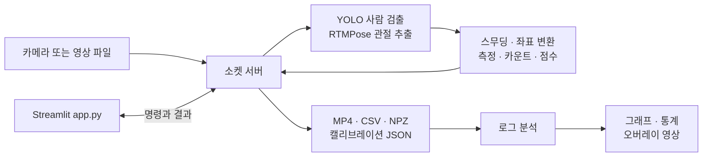
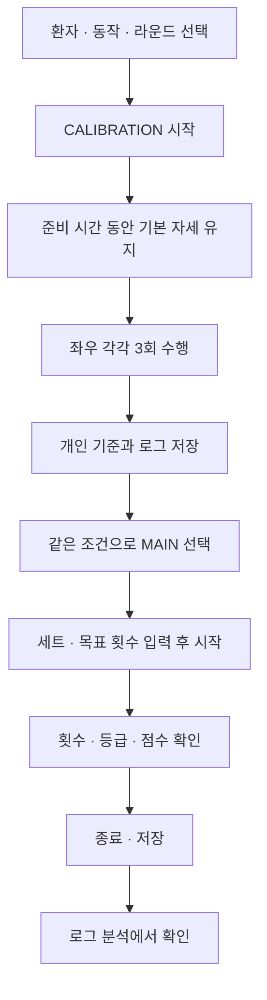
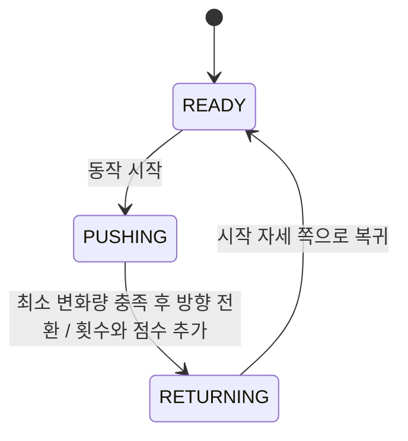

# 모션 측정 서버와 Streamlit 실험 화면

카메라에서 사람의 관절을 찾고, 운동별 측정값으로 **반복 횟수와 동작 점수**를 계산하는 프로젝트입니다. 결과는 WebSocket으로 전달하며, 촬영 영상과 측정 로그를 저장합니다. Streamlit에서는 측정을 제어하고 저장된 로그를 분석할 수 있습니다.

이 문서는 **현재 소스 코드 기준**의 실행·사용 안내입니다.

- [소켓 서버 사용 설명서](SOCKET_SERVER_GUIDE.md): 다른 프로그램에서 연결하는 방법, 명령·응답, 입력 필드, Python 예제
- [로그 분석 상세 안내](analysis/README.md): 분석 화면과 오버레이 영상
- [운동 설정 JSON](configs/exercise_kpt_config_coco.json): 운동별 관절, 측정 방식, 정규화와 기본 기준
- [발표용 HTML](presentation.html): 시스템 구조·측정 원리·분석 흐름을 설명하는 14장 슬라이드. 브라우저에서 열고 `←`·`→`로 이동하며, `F`로 전체 화면, `N`으로 발표 메모를 표시합니다. 그림은 `img/`에 있어 인터넷 없이 사용할 수 있습니다.

## 목차

1. [전체 구조](#1-전체-구조)
2. [실행 방법](#2-실행-방법)
3. [처음 측정하는 순서](#3-처음-측정하는-순서)
4. [화면 설정](#4-화면-설정)
5. [운동별 측정 방식](#5-운동별-측정-방식)
6. [카운트·점수·진행 바](#6-카운트점수진행-바)
7. [영상·관절·스무딩](#7-영상관절스무딩)
8. [로그와 기준값 저장](#8-로그와-기준값-저장)
9. [로그 분석](#9-로그-분석)
10. [설정과 코드 안내](#10-설정과-코드-안내)
11. [문제 해결](#11-문제-해결)

## 1. 전체 구조



| 구성 | 역할 | 실행 방법 |
|---|---|---|
| 소켓 서버 | 카메라, AI 추론, 운동 측정, 파일 저장 | `python server_entry.py` |
| Streamlit | 조건 입력, 시작·종료, 상태 확인, 분석 | `python -m streamlit run app.py` |
| 영상 전용 창 | 영상에 관절·횟수·점수·바 표시 | Streamlit에서 자동 실행 |
| 분석 코드 | 저장된 CSV·NPZ·MP4 읽기 | `analysis/` |

서버와 Streamlit은 별도 프로그램입니다. 실시간 실험에는 둘 다 실행합니다. **저장된 로그만 분석할 때는 Streamlit만 실행해도 됩니다.** Unity 등 다른 클라이언트는 Streamlit 없이 서버에 직접 연결할 수 있습니다.

## 2. 실행 방법

### 실행 환경

현재 사용 환경은 Conda의 `rtm_env`입니다. 서버는 OpenCV, NumPy, websockets, PyTorch, Ultralytics, MMPose, MMEngine, MMCV 등을 사용합니다. 분석 화면은 Streamlit, pandas 등의 패키지도 사용합니다.

현재 저장소에는 전체 AI 환경을 재현하는 `requirements.txt`나 Conda 환경 파일이 없습니다. **이미 AI 추론이 동작하는 환경을 기준으로 실행하세요.** Streamlit만 설치한다고 모델 추론 환경까지 준비되지는 않습니다.

다음 모델 파일이 필요합니다.

```text
configs/checkpoints/
├── yolov8n.pt
├── RTMPose_config.py
└── RTMPose.pth
```

CUDA를 사용할 수 있으면 GPU를, 그렇지 않으면 CPU를 선택합니다. CPU에서는 처리 속도가 느려질 수 있습니다. 웹캠 코드는 Windows의 DirectShow와 Media Foundation을 사용합니다.

### 터미널 1: 소켓 서버

프로젝트 폴더에서 실행합니다.

```powershell
conda activate rtm_env
python server_entry.py
```

기본 주소는 **`ws://127.0.0.1:8080`**입니다. 서버가 먼저 포트를 열고 모델을 백그라운드에서 불러옵니다. 연결이 가능해도 모델 준비는 진행 중일 수 있습니다. 준비 전 측정 요청은 대기했다가 실행됩니다.

### 터미널 2: Streamlit

```powershell
conda activate rtm_env
python -m streamlit run app.py
```

브라우저에서 **http://localhost:8501**에 접속합니다. Streamlit이 없다면 같은 환경에서 설치합니다.

```powershell
python -m pip install streamlit
```

Windows 정책에서 `streamlit.exe`가 차단되는 경우에도 `python -m streamlit` 방식으로 실행해 보세요. Python 자체가 차단된다면 해당 PC의 실행 정책을 확인해야 합니다.

### 종료

측정 중에는 먼저 앱의 **종료 · 저장**으로 세션을 마무리합니다. 이후 각 터미널에서 `Ctrl+C`를 누릅니다. 강제 프로세스 종료나 전원 차단은 파일 마무리를 보장하지 않습니다.

## 3. 처음 측정하는 순서



1. **측정** 탭에서 환자번호·동작·라운드를 입력합니다.
2. 측정 모드는 `CALIBRATION`, 실행 방식은 처음에는 `VISUAL`을 선택합니다.
3. 카메라 번호를 선택합니다. 기본값은 `0`입니다.
4. **측정 시작**을 누르고 기본 준비 시간 5초 동안 자세를 잡습니다.
5. 필요한 관절이 화면에 보이도록 하고 좌우 각각 3회를 수행합니다.
6. 완료되면 세션은 끝나지만 소켓 서버와 모델은 계속 실행됩니다. 감시 연결이 있으면 미리보기도 유지됩니다.
7. `MAIN`으로 바꾸고 같은 라운드의 세트·목표 횟수를 입력해 본측정합니다.
8. 종료 후 저장 결과를 확인하고 **로그 분석**에서 엽니다.

**MAIN은 해당 조건의 완료된 캘리브레이션이 필요합니다.** 환자·날짜·동작·라운드뿐 아니라 데이터 버전·등록 차수도 일치해야 합니다. 다른 날짜나 라운드의 기준을 자동으로 가져오지 않습니다.

## 4. 화면 설정

### 측정 모드와 실행 방식의 차이

측정 모드는 **무엇을 위한 측정인지** 정합니다.

| 측정 모드 | 목적 | 끝내는 주체 |
|---|---|---|
| `CALIBRATION` | 개인별 본측정 기준 획득 | 좌우 각각 3회 후 서버가 완료 |
| `MAIN` | 개인 기준으로 횟수와 점수 측정 | 클라이언트가 종료 명령 전송 |

별도의 `TEST` 측정 모드는 현재 지원하지 않습니다.

실행 방식은 **어디서 영상을 받고 무엇을 전송할지** 정합니다.

| 실행 방식 | 입력 | 소켓 결과 | 저장 |
|---|---|---|---|
| `VISUAL` | 서버 PC 카메라 | 수치와 영상 미리보기 | MP4·CSV·NPZ |
| `LIGHTWEIGHT` | 서버 PC 카메라 | 수치 | MP4·CSV·NPZ |
| `OFFLINE_VIDEO` | 서버 PC의 영상 파일 | 진행 상황과 분석 결과 | MP4·CSV·NPZ |

`LIGHTWEIGHT`도 카메라를 사용하고 촬영 영상을 저장합니다. 미리보기 전송을 생략하는 방식입니다. `OFFLINE_VIDEO`는 카메라 대신 지정한 파일을 분석합니다.

### 자주 쓰는 입력

| 입력 | 의미 |
|---|---|
| 환자번호 | 숫자 최대 4자리. 예: `0000` |
| 동작 | 측정할 운동 |
| 라운드 | 캘리브레이션과 본측정을 묶는 번호 |
| 세트 | 같은 라운드에서 몇 번째 본측정인지 구분 |
| 목표 횟수 | 좌우 각각의 목표. 캘리브레이션은 3회 고정 |
| 양쪽 모두 목표 횟수에 도달하면 종료 · 저장 | Streamlit이 횟수를 보고 종료 명령을 보내는 기능 |
| 카메라 번호 | 서버 PC의 카메라 인덱스. 장치 이름과 번호의 대응은 PC마다 다름 |
| 영상 파일 경로 | 파일 분석에 사용할 서버 PC 경로 |

자동 종료를 켜고 10회로 정하면 **좌우 모두 10회 이상**이어야 앱이 종료 명령을 보냅니다. 누적 점수 10점과는 다릅니다. 서버에 `target_reps`만 보내서는 MAIN이 자동 종료되지 않습니다.

**연결 · 입력 설정**에는 소켓 주소, 준비 시간, 로그 폴더, 세션 번호, 등록 차수, 슬롯, 데이터 버전, 참고 목표 점수, 분석 배치 크기, 외부 연동 ID, 환자 메타데이터가 있습니다. 일반 실험은 기본값으로 시작할 수 있습니다. 형식과 기본값은 [소켓 필드 설명](SOCKET_SERVER_GUIDE.md#4-측정-시작-필드)을 참고하세요.

경로의 기준 PC를 구분하세요. **카메라 번호·입력 영상·로그 저장 경로는 소켓 서버 PC**, 분석에서 직접 여는 경로와 영상 전용 창은 **Streamlit 실행 PC** 기준입니다.

## 5. 운동별 측정 방식

설정 파일은 [exercise_kpt_config_coco.json](configs/exercise_kpt_config_coco.json)입니다.

| 동작 ID | 주요 관절 | 캘리브레이션 측정값 | MAIN 측정값 | 몸통 정규화 |
|---|---|---|---|---|
| `biceps_curl` | 손목 | 손목 Y | 손목 Y | 사용 |
| `shoulder_press` | 어깨·팔꿈치·손목 | 팔꿈치 각도 | 같은 각도 | 사용 |
| `clamshell` | 양쪽 골반·무릎 | 골반 부위 각도 | 같은 각도 | 사용 |
| `slr` | 발목 | 발목 Y | 발목 Y | 사용 |
| `hip_knee_flexion` | 어깨·골반·무릎 | 골반 부위 각도 | 같은 각도 | 사용 |
| `knee_extension` | 무릎·발목 / 발목 | 무릎–발목 2D 길이 감소 | 캘리브레이션에서 저장한 발목 Y 범위 | 사용 안 함 |

기본 지표는 `ANGLE`(세 관절의 각도), `COORDINATE`(관절 좌표), `LENGTH`(두 관절 거리)입니다. 무릎 신전의 캘리브레이션은 `LENGTH`, 본측정은 `COORDINATE`를 사용합니다.

### norm과 unnorm

- **norm**: 골반 중심을 원점으로 옮기고 몸통 길이를 1로 맞춥니다. 위쪽이 +Y입니다. 화면 속 위치·신체 크기 차이를 줄이는 목적입니다.
- **unnorm**: 몸통 변환을 하지 않습니다. 추출한 관절은 기본적으로 `x / 영상 너비`, `y / 영상 높이`인 영상 비율 좌표입니다. 아래쪽이 +Y입니다.

정규화를 끈다고 바로 픽셀 좌표가 되는 것은 아닙니다. knee extension의 Y `0.7`은 영상 높이의 70% 위치입니다. 측정용 X축은 필요에 따라 가로세로 비율을 보정합니다. 각도는 도(°), 상대 이동량은 비율이므로 그래프의 단위를 확인하세요.

### 캘리브레이션

일반 동작은 안정된 기본 자세를 확인한 뒤 JSON 시작→목표 범위의 **30%**에 도달하면 반복을 인정합니다. **15% 이하로 복귀하고 다시 준비되어야 다음 반복**을 셉니다. 100% 도달이 필수는 아닙니다.

JSON 기본 범위는 캘리브레이션 시작에 쓰는 기준입니다. 완료 후에는 관찰한 기본 자세와 동작 변화량으로 개인 시작값·목표값을 저장해 MAIN에서 사용합니다. 모든 환자의 최종 목표를 JSON 값 하나로 고정하는 구조는 아닙니다.

### Knee extension의 두 단계

캘리브레이션에서는 몸통 정규화 없이 무릎–발목의 화면상 직선거리를 사용합니다. 가로세로 비율을 보정한 영상 좌표에서 계산하며, 종아리 길이로 이동량을 나누지 않습니다.

```text
종아리 2D 길이 = sqrt((발목 X - 무릎 X)^2 + (발목 Y - 무릎 Y)^2)
```

기본 자세를 0.8초 확인한 뒤, 초기 잡음과 최소 변화량으로 길이 감소 조건을 정합니다. 감소가 0.15초 지속되면 횟수를 올리고, 복귀해야 다음 동작을 받습니다. 방향은 `DECREASING`으로 고정합니다. 좌우 각각 3회와 마지막 복귀를 확인한 후 완료합니다. 캘리브레이션 바는 처음 확정한 기본 길이에서 0까지의 고정 범위입니다.

동작 수집과 동시에 발목의 몸통 정규화하지 않은 Y좌표를 기록합니다. 기본 자세 Y 중앙값을 시작값으로, 각 반복의 최소 Y 세 개의 중앙값을 대표 신전 위치로 삼습니다. 시작값에서 대표 신전 위치까지의 **85% 위치**를 MAIN 목표로 저장합니다. MAIN은 이 발목 Y 범위를 고정해서 기존 Perfect·Good·Normal 판정을 사용합니다. 이는 관찰된 데이터에 대한 기준이며 실제 최대 신전 위치를 보장하는 값은 아닙니다.

MAIN에서는 저장한 시작 Y·목표 Y를 고정해서 발목 도달 정도를 계산합니다. 종아리 길이를 새로 계산하거나 몸통 정규화를 하지 않습니다. 발목이 올라가면 영상 Y는 작아집니다. 카운트와 3등급 점수는 아래 방식을 사용합니다.

카메라 각도·환자 위치를 크게 바꾸면 고정 Y 기준도 맞지 않으므로 다시 캘리브레이션하세요. 2D 좌표만으로 보상 동작을 모두 구별할 수 있는 것은 아닙니다.

## 6. 카운트·점수·진행 바

### MAIN의 카운트 시점

현재 등록된 본측정 동작은 **최고 도달점에서 되돌아오는 움직임을 확인**해 카운트합니다.



| 조건 | Knee extension MAIN | 다른 등록 동작 MAIN |
|---|---|---|
| 유효한 최고 도달 비율 | 35% 이상 | 40% 이상 |
| 방향 전환 확인 | 전체 기준 범위의 5% 이상 되돌아옴 | 같음 |
| 다음 반복 준비 | 진행률 15% 이하 복귀 | 진행률 30% 이하 복귀 |

캘리브레이션은 활성 기준 도달 시 횟수를 추가하지만 MAIN은 최고점에서 조금 되돌아왔을 때 추가합니다. 완전히 다 내릴 때까지 기다리는 조건은 아닙니다.

### 품질 등급과 점수

시작을 0%, 목표를 100%로 두고 그 반복의 **최고 도달 비율**로 판정합니다.

| 화면 이름 | 최고 도달 비율 | 소켓 `quality` | 판정 코드 `score` | 추가 점수 `score_delta` |
|---|---|---|---|---|
| Perfect | 70% 이상 | `PERFECT` | 3 | +1.00 |
| Good | 50% 이상, 70% 미만 | `GOOD` | 2 | +0.50 |
| Normal | 35% 이상, 50% 미만 | `BAD` | 1 | +0.25 |

등급 조건과 함께 위의 카운트 성립 조건도 충족해야 합니다. 예를 들어 일반 동작의 37% 움직임은 최소 활성 40%에 못 미쳐 횟수가 추가되지 않습니다.

`BAD`는 소켓 호환용 이름이며 화면에서는 Normal입니다. **`score = 3`은 3점이 아니라 판정 코드**입니다. Perfect→Good→Normal을 한 번씩 하면 3회, 총 1.75점입니다.

`total_score`는 누적값입니다. 카운트가 없는 프레임에는 `score`·`score_delta`가 0으로 돌아갈 수 있습니다. 외부 프로그램은 `REP_COMPLETED`로 마지막 등급을 보관하세요. 캘리브레이션 성공 횟수에는 본측정 3등급 평가를 적용하지 않습니다.

### 우측 진행 바

바는 지금의 동작 진행 정도입니다. 횟수나 누적 점수가 아닙니다.

- 일반 지표: `(현재값 - 시작값) / (목표값 - 시작값)`을 0~100% 범위로 표시합니다.
- 상대 이동량: 고정 기준 길이에 대한 이동 비율을 사용합니다.
- 캘리브레이션 30% 카운트 기준과 바의 100%는 다릅니다. 카운트되었다고 곧바로 바가 가득 차지 않습니다.
- MAIN은 저장된 개인 기준을 바의 시작·목표로 사용합니다.

## 7. 영상·관절·스무딩

### 보이는 관절과 측정 관절

실시간 스켈레톤은 **스무딩 전 관절**을 그립니다. 측정값·카운트·바에는 **스무딩된 결과**를 사용합니다. 점과 바의 순간 반응은 다를 수 있습니다. 얼굴 관절은 그리지 않습니다.

일반 측정에는 One Euro 필터를 적용합니다. 상대 이동량은 중복 스무딩을 피하기 위해 내부의 짧은 EMA 필터를 사용합니다. 필터를 약하게 해도 모델 추론·카메라·전송 시간은 남습니다.

### 미리보기와 저장 영상

| 구분 | 동작 |
|---|---|
| 카메라 입력 | 1280×720 이상을 요청하고 실제 프레임 크기 검사 |
| 미리보기 | 기준 영상 최대 640×360, 최대 10 FPS, JPEG 품질 60 |
| 촬영 MP4 | 축소 미리보기 대신 원본 해상도 프레임 저장. 오버레이 없음 |
| 파일 분석 MP4 | 입력 영상 해상도 사용. 저해상도 원본을 실제 HD로 복원하지 않음 |
| 분석 오버레이 MP4 | 저장된 MP4·NPZ를 합성해 별도 생성 |

미리보기에는 우측 정보 패널이 추가될 수 있어 최종 너비는 카메라 영상의 축소 너비와 다를 수 있습니다. 저장은 시간축에 맞춰 프레임을 재사용할 수 있습니다. 파일의 FPS가 매초 서로 다른 AI 추론 프레임 수를 뜻하지는 않습니다.

### 영상 전용 창

`VISUAL` 측정 시작 시 Streamlit 실행 PC에 **Motion Camera** OpenCV 창이 자동으로 열립니다. `Esc`나 창 닫기로 닫고 앱의 **영상 창 다시 열기**로 다시 열 수 있습니다. 창만 닫는 것은 측정 종료가 아닙니다.

미리보기는 측정과 별도 연결을 사용해 모델 로딩·준비·측정 완료 중에도 유지합니다. 필요한 관절이 보이지 않으면 자세 조정 안내를 표시합니다. 카메라·네트워크가 끊기면 마지막 영상과 경고를 보여주며 복구를 시도합니다. 이때 마지막 화면은 새로운 영상이 아닐 수 있습니다.

원격 브라우저로 접속해도 창은 **Streamlit 서버 PC**에 열립니다. GUI 없는 서버에서는 이 창을 사용할 수 없습니다.

## 8. 로그와 기준값 저장

### 폴더와 파일명

기본 구조는 **환자 / 날짜 / 동작**입니다. 라운드 폴더를 추가하지 않습니다. 아래 시간은 예시입니다.

```text
data/
└── 0000/
    ├── patient_metadata.csv
    └── 2026-10-28/
        └── knee_extension/
            ├── 09-00-00_CALIBRATION_round02.csv
            ├── 09-00-00_CALIBRATION_round02.npz
            ├── 09-00-00_CALIBRATION_round02.mp4
            ├── round02_thresholds_v01.json
            ├── 09-10-00_MAIN_round02_set01.csv
            ├── 09-10-00_MAIN_round02_set01.npz
            └── 09-10-00_MAIN_round02_set01.mp4
```

- 캘리브레이션은 `시-분-초_CALIBRATION_round번호`이며 세트를 넣지 않습니다.
- MAIN은 `시-분-초_MAIN_round번호_set번호`입니다.
- 날짜는 측정 시작 시각의 한국 시간 기준입니다.
- 중복 이름은 `_take2`, `_take3` 등을 붙여 보존합니다.
- 긴 무작위 세션 ID는 파일명 대신 로그 내부에 기록합니다.

저장 루트 우선순위는 **요청의 `log_root` → 환경변수 `ASAN_LOG_ROOT` → 프로젝트 `data`**입니다.

```powershell
$env:ASAN_LOG_ROOT = 'D:\ASAN_logs'
python server_entry.py
```

### 세 가지 로그

| 파일 | 내용 | 용도 |
|---|---|---|
| MP4 | 오버레이 없는 원본 해상도 영상 | 실제 동작 확인, 합성 입력 |
| CSV | 시간별 측정값·횟수·상태·점수·기준값 | 표·그래프·이벤트 분석 |
| NPZ | 관절 배열, 시간, 측정값·횟수·상태·점수, JSON 형식 요약 | 관절 비교, Python 분석, 합성 |

CSV는 측정 중 행을 기록하고, NPZ와 영상 등은 종료 과정에서 최종 마무리합니다. 종료 응답 후 결과를 확인하세요. 요약은 NPZ의 `summary_json`, 반복별 기록은 `reps_json`에 있습니다. 별도 요약 JSON·반복 CSV를 매번 추가 생성하는 방식은 아닙니다.

NPZ를 Python으로 확인하는 예입니다. 키는 로그 생성 시점에 따라 다를 수 있습니다.

```python
import json
import numpy as np

path = 'data/0000/2026-10-28/knee_extension/09-10-00_MAIN_round02_set01.npz'
with np.load(path, allow_pickle=False) as log:
    print(log.files)
    print(log['keypoints'].shape)  # (측정 프레임 수, 17개 관절, x/y/신뢰도)
    info = json.loads(log['summary_json'].item())
    print(info.get('calibration'))
```

### 캘리브레이션 버전

완료될 때마다 `round02_thresholds_v01.json`, `v02.json`처럼 새 버전을 만듭니다. 이전 결과를 덮어쓰지 않습니다.

MAIN은 환자·날짜·동작·라운드·데이터 버전·등록 차수가 일치하는 최신 확정 결과를 사용합니다. 세트가 달라도 같은 라운드의 기준을 사용할 수 있습니다. 다른 날짜·라운드로 자동 대체하지 않습니다.

MAIN 로그에는 적용 파일·버전·시각과 기준값 사본을 남깁니다. 이후 새 캘리브레이션이 생겨도 과거 MAIN 기준이 바뀌지 않습니다. 분석 화면에서 이 정보를 확인할 수 있습니다.

기존 `data/0000/0000.json`은 과거 데이터로 보존하지만 현재 새 측정의 기준을 읽고 쓰는 파일은 아닙니다. **오래된 로그를 자동 삭제하는 기능은 아직 없습니다.**

## 9. 로그 분석

소켓 서버 없이 `python -m streamlit run app.py`로 실행할 수 있습니다.

1. **로그 분석**에서 폴더·파일 경로를 입력하거나 CSV·NPZ를 업로드합니다.
2. 환자·날짜·동작 필터를 사용합니다. 비어 있으면 전체이며 여러 항목을 선택할 수 있습니다. 같은 필터 내 선택은 합집합, 서로 다른 필터는 교집합입니다.
3. 세션을 선택합니다. 같은 이름의 CSV·NPZ는 함께 읽습니다.
4. 시간 구간·좌우를 정하고 필요한 분석 화면을 엽니다.

| 화면 | 확인 내용 | 입력 |
|---|---|---|
| 측정 분석 | 측정값 변화, 기준, 카운트 시점, 등급·점수·측정 상태 | CSV 또는 충분한 기록이 있는 NPZ |
| 관절 비교 | 핵심 관절 X·Y·신뢰도, norm/unnorm | 관절 데이터가 있는 NPZ |
| 상세 데이터 | 원본 표·통계·요약·기준 연결 정보·CSV 다운로드 | CSV·NPZ |
| 오버레이 영상 | 관절·횟수·등급·점수·바가 있는 MP4 생성 | 같은 세션의 NPZ·MP4, 필요시 CSV |

### 그래프 해석

측정 분석 곡선은 **해당 동작의 실제 측정값**입니다. 각도 동작은 각도, knee MAIN은 발목 Y입니다. 관절 비교의 좌표 곡선과 구분하세요.

시작 기준은 회색, 목표는 검정 계열, Perfect는 초록, Good은 주황, Normal은 보라입니다. 가로 기준선은 값 축의 기준이며 정규화를 켰다는 표시가 아닙니다. **세로 점선은 카운트 시점**입니다.

같은 `threshold_version` 안에서는 기준을 고정해서 보여줍니다. 명시적인 수정으로 버전이 바뀌면 계단처럼 달라질 수 있습니다. 과거 로그의 이동하는 내부 판정 기준은 별도 진단으로 구분하며 원본을 바꾸지 않습니다.

norm/unnorm 선택은 관절 궤적을 다른 좌표계로 보는 기능입니다. **기록된 측정값·카운트·점수를 다시 계산하지 않습니다.** 몸통 관절이 없거나 신뢰도가 낮으면 norm 그래프에 빈 구간이 생길 수 있습니다.

### 오버레이 영상

같은 세션의 NPZ·MP4를 선택하고 필요하면 CSV로 보완합니다. 기본 결과 폴더는 `analysis/outputs/overlay_videos/`이며 원본과 기존 결과를 덮어쓰지 않습니다.

이 기능은 저장된 결과를 영상에 합성합니다. AI 재추론이나 새로운 카운트 실험이 아닙니다. 그래프에서 선택한 시간 구간과 별개로 전체 원본 영상을 생성하며, 원본 오디오는 넣지 않습니다.

브라우저 재생용 H.264 변환에는 FFmpeg가 필요합니다. PATH → 프로젝트 내부 도구 → 설치된 `imageio_ffmpeg` 순으로 찾습니다. 필요한 경우 다음처럼 프로젝트 내부에 도구를 설치할 수 있습니다.

```powershell
python -m pip install --no-deps --target analysis/tools/video imageio-ffmpeg==0.6.0
```

FFmpeg가 없으면 MPEG-4로 저장될 수 있지만 브라우저에서 재생되지 않을 수 있습니다. 다운로드해 플레이어로 보거나 FFmpeg 준비 후 다시 생성하세요. 자세한 내용은 [분석 안내](analysis/README.md)를 참고하세요.

## 10. 설정과 코드 안내

### 운동 JSON

| 항목 | 의미 |
|---|---|
| `eval_config.metric_type` | 기본 측정 지표 |
| `target_kpt`, `primary_kpts` | 대상 관절, 각도 계산의 세 관절 |
| `axis` | 좌표 축 |
| `motion_direction` | 운동 시 값이 증가/감소하는 방향 |
| `use_normalization` | 몸통 정규화 여부 |
| `default_thresholds` | 캘리브레이션의 시작·목표 기준 |
| `main_eval_config` | MAIN에서 덮어쓸 측정 설정 |
| `min_activation_ratio`, `return_ratio` | 최소 변화량과 다음 반복 복귀 비율 |
| `calibration_target_fraction` | 관찰 변화량 중 본측정 목표로 사용할 비율 |

설정 변경 후에는 서버를 재시작하고 새로 캘리브레이션하는 것이 좋습니다. 지표·좌표계를 바꾸고 이전 기준을 쓰면 단위가 맞지 않을 수 있으며, 호환되지 않는 기준은 시작 시 거절될 수 있습니다.

실험용 영상 기능을 끄려면 `network/session_commands.py`의 `ENABLE_EXPERIMENTAL_MODES = False`로 설정합니다. 그러면 `LIGHTWEIGHT`만 제공합니다. `experimental_modes.py`가 없어도 수치 서버를 실행하도록 구성되어 있습니다.

### 코드 위치

| 위치 | 역할 |
|---|---|
| `server_entry.py` | 서버 실행 진입점 |
| `app.py` | Streamlit 화면 |
| `network/socket_server.py` | 연결·명령·세션 소유권·실시간 루프 |
| `network/session_commands.py` | 실행 방식·입력 검사·기준 명령 |
| `network/camera.py` | HD 카메라와 최신 프레임 |
| `network/experimental_modes.py` | 미리보기 인코딩·파일 분석 |
| `network/live_preview.py` | 측정과 분리된 영상 감시 |
| `network/streamlit_live.py`, `network/video_window.py` | 앱 통신·영상 창 |
| `core/skeleton_engine.py`, `core/model_loader.py` | AI 추론·비동기 로딩 |
| `core/session_controller.py` | 캘리브레이션·본측정 흐름 |
| `core/motion_engine.py` | 지표·카운트·등급·점수 |
| `core/relative_displacement.py` | 기준 길이에 대한 상대 이동량 |
| `core/target_position.py` | 별도 목표 위치 판정. 현재 knee MAIN 기본은 `PEAK_REVERSAL` |
| `core/data_manager.py`, `core/session_log.py` | 기준 버전·파일 저장 |
| `utils/filters.py`, `utils/normalization.py` | 필터·좌표 변환 |
| `utils/measurement_progress.py`, `utils/pose_overlay.py`, `utils/quality_display.py` | 바·영상·등급 표시 |
| `analysis/` | 로그 읽기·그래프·영상 합성 |

## 11. 문제 해결

| 증상 | 먼저 확인할 것 |
|---|---|
| Streamlit 접속 실패 | 앱 실행 여부와 `localhost:8501` 주소 |
| 소켓 연결 실패 | 서버 실행 여부와 `ws://127.0.0.1:8080` 주소 |
| 8080 포트 사용 중 | 이미 실행된 서버 확인. 새 서버를 반복 실행하지 않기 |
| 모델 준비 실패 | 서버 오류, 환경, 모델 파일, CUDA·AI 패키지 호환 |
| 카메라 연결 실패 | 번호, 다른 앱의 점유, 실제 1280×720 이상 출력 |
| MAIN 시작 실패 | 같은 환자·날짜·동작·라운드·버전·등록 차수의 완료된 캘리브레이션 |
| 서버가 사용 중 | 기존 연결에서 종료 · 저장. 끊긴 세션은 앱의 이전 연결 정리 기능 |
| 관절 경고 | 운동에 필요한 관절의 화면 진입·가림·조명·신뢰도 |
| 영상은 나오지만 카운트 안 됨 | 준비 상태·최소 변화량·방향 전환·다음 반복 복귀 |
| MAIN이 목표에서 안 끝남 | 좌우 목표 도달, 앱 자동 종료 체크. 직접 연결은 종료 명령 필요 |
| 미리보기 화질 낮음 | 축소가 정상 동작. 저장 MP4의 실제 해상도 확인 |
| 영상 창이 다른 PC에 뜸 | 창은 Streamlit 실행 PC에 열림 |
| 관절 그래프가 비어 있음 | NPZ·선택 구간·관절·신뢰도·norm용 몸통 관절 |
| 합성 영상이 비거나 어긋남 | 같은 세션의 MP4·NPZ·CSV와 시간 보정 |
| 생성 영상 브라우저 재생 실패 | FFmpeg 준비 후 H.264로 재생성 또는 다운로드 재생 |

서버에 직접 연결하려면 [소켓 서버 사용 설명서](SOCKET_SERVER_GUIDE.md)를 참고하세요.
