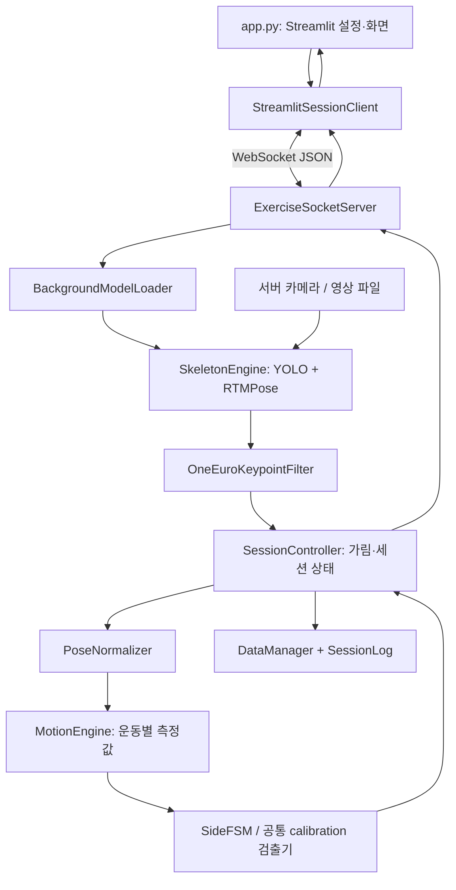
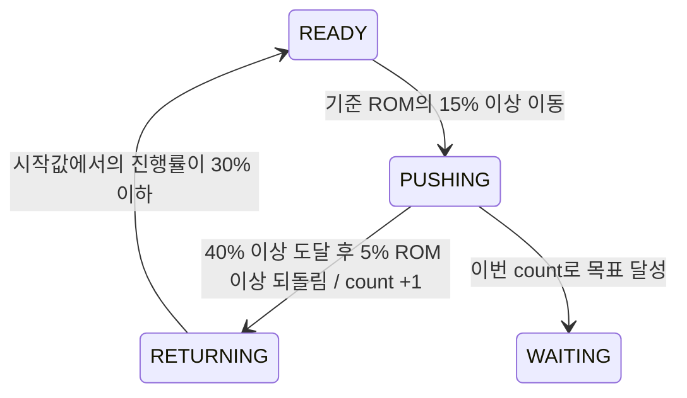

# ASAN 실시간 운동 측정 시스템

카메라 또는 영상 파일에서 사람의 관절을 추출하고, 운동별 측정값·반복 횟수·수행 점수를 계산하는 Python 프로젝트입니다. Streamlit은 설정과 결과 표시를 담당하고, WebSocket 서버가 카메라·AI 모델·운동 판정·기록을 담당합니다.

이 문서는 현재 소스 코드를 기준으로 파일의 역할과 처리 흐름을 설명합니다. 요청에 따라 `tests/`와 `data/`의 내용은 설명하지 않습니다. 영상과 모델 가중치 같은 바이너리는 파일 종류별로 묶어 설명합니다. `.git/`, `__pycache__/` 같은 관리·자동 생성 파일은 소스 설명 대상에서 제외합니다.

## 1. 실행 방법

프로젝트 루트에서 모델과 의존성이 설치된 환경을 사용합니다.

서버 터미널:

```powershell
conda activate rtm_env
python network/socket_server.py
```

Streamlit 터미널:

```powershell
conda activate rtm_env
streamlit run app.py
```

기본 서버 주소는 `ws://127.0.0.1:8080`입니다. 같은 PC에서는 인터넷이나 Wi-Fi 없이 로컬 통신할 수 있습니다. 모델·패키지의 최초 설치나 다운로드는 별개입니다. 서버의 기본 바인딩이 `127.0.0.1`이므로 다른 PC 접속은 별도 네트워크·바인딩 설정이 필요합니다.

실시간 모드의 카메라는 **서버가 실행되는 PC의 카메라**입니다. 브라우저에서 촬영해 서버로 전송하는 구조가 아닙니다. 영상 파일 경로와 기록 경로도 서버 기준으로 해석됩니다.

## 2. 파일 구조

```text
.
├── README.md
├── .gitignore
├── .vscode/
│   └── settings.json
├── app.py
├── window_config_for_40Series.bat
├── window_config_for_50Series.bat
├── configs/
│   ├── exercise_kpt_config_coco.json
│   └── checkpoints/
│       ├── RTMPose_config.py
│       ├── RTMPose.pth
│       └── yolov8n.pt
├── core/
│   ├── model_loader.py
│   ├── skeleton_engine.py
│   ├── motion_engine.py
│   ├── session_controller.py
│   ├── data_manager.py
│   └── session_log.py
├── network/
│   ├── socket_server.py
│   ├── streamlit_client.py
│   ├── session_commands.py
│   ├── test_client.py
│   └── threshold_test_client.py
├── utils/
│   ├── filters.py
│   ├── normalization.py
│   ├── overlay_renderer.py
│   └── calibration_subtitles.py
├── docs/
│   ├── count_thresholds.md
│   ├── log_storage.md
│   └── calibration_video_experiments.md
└── test_video/
    ├── README_calibration.md
    └── 운동별 영상 및 ASS 자막
```

`network/test_client.py`, `network/threshold_test_client.py`는 이름에 test가 있지만 `tests/` 폴더의 자동 테스트가 아니라 직접 실행하는 보조 클라이언트이므로 아래에서 설명합니다.

## 3. 전체 처리 흐름



핵심 책임은 다음과 같습니다.

| 작업 | 담당 |
|---|---|
| 사용자 입력과 결과 표시 | `app.py` |
| UI 재실행 중에도 유지되는 통신 | `network/streamlit_client.py` |
| 카메라 소유·명령 처리·실시간/파일 분석 분기 | `network/socket_server.py` |
| 사람 및 관절 좌표 추론 | `core/skeleton_engine.py` |
| 좌표 흔들림 완화 | `utils/filters.py` |
| 골반 중심·몸통 길이 기준 좌표 변환 | `utils/normalization.py` |
| 관절 좌표를 운동 측정값으로 변환 | `core/motion_engine.py` |
| Calibration 진행과 세션 완료 판단 | `core/session_controller.py` |
| 모든 방식의 calibration 반복 검출 | `core/session_controller.py`의 `CalibrationCycleDetector` |
| 개인 기준 관리·기록 생명주기 | `core/data_manager.py`, `core/session_log.py` |

## 4. 루트 파일

### `app.py` — Streamlit 화면

서버 주소, 환자 식별값, 운동 종류, 실행 모드, 카메라 번호, 영상 경로, 목표 점수, 녹화 여부 등을 입력받습니다. 세션을 시작하면 `StreamlitSessionClient`를 만들고 `st.session_state`에 보관합니다.

주요 함수:

| 함수 | 동작 |
|---|---|
| `load_exercise_config()` | 운동 목록과 한글 표시명을 읽어 선택 항목을 구성합니다. |
| `draw_hud_overlay()` | 영상 위에 횟수·점수·진행 상태를 그립니다. |
| `render_pose_update()` | 받은 영상 또는 관절 화면과 좌우 정보를 표시합니다. |
| `render_rom_editor()` | 실시간 MAIN/TEST 세션의 시작값·목표값 편집 화면입니다. |
| `refresh_session()` | 0.2초 주기의 Streamlit fragment에서 통신 상태·수신 이벤트·측정 결과를 갱신합니다. |
| `main()` | 설정 UI를 만들고 시작·중지·결과 화면을 연결합니다. |

UI 위젯을 바꿀 때 Streamlit 스크립트는 재실행되지만, 이미 생성된 통신 객체의 연결은 유지합니다. ROM 변경 요청에는 `request_id`를 붙이고, 서버의 적용 응답과 `threshold_version`을 확인해 화면에 반영합니다.

UI의 세 가지 검증 방식과 운동 실행 모드는 서로 다른 설정입니다.

| 검증 방식 | 입력과 출력 |
|---|---|
| 모드 1 / VISUAL | 서버 웹캠 사용. 관절·측정값과 압축 영상을 표시합니다. |
| 모드 2 / LIGHTWEIGHT | 서버 웹캠 사용. 영상 없이 측정값 중심으로 통신합니다. |
| 모드 3 / Video Batch | 서버의 영상 파일을 배치 분석합니다. 실시간 ROM 편집은 비활성화됩니다. |

운동 실행 모드는 `CALIBRATION`, `TEST`, `MAIN`입니다. 검증 방식의 “모드 1·2·3”과 혼동하지 않아야 합니다.

### `window_config_for_40Series.bat` — RTX 40 계열 환경 구성

Conda의 `rtm_env`를 제거하고 Python 3.10 환경을 다시 만든 뒤, PyTorch 2.1.2/CUDA 12.1 계열과 OpenMMLab·영상·UI 라이브러리를 설치합니다. 마지막에 주요 모듈 import와 버전을 확인합니다.

**기존 `rtm_env`를 삭제하는 스크립트**이므로 단순 실행용 런처가 아닙니다. 이 파일의 설치 목록에는 `websockets`가 명시되어 있지 않아, 해당 모듈이 없다면 추가 설치가 필요합니다.

### `window_config_for_50Series.bat` — RTX 50 계열 환경 구성

같은 이름의 Conda 환경을 재생성하며, CUDA 12.8 계열 PyTorch와 `mmcv-lite`를 설치하는 경로입니다. `mim.exe` 대신 `python -m pip`를 사용하는 설치 단계가 많고, `websockets` 설치와 GPU 인식 확인이 포함됩니다.

이 파일도 기존 환경을 제거합니다. 두 BAT 파일은 환경을 선택해 구성하기 위한 것이며 연속 실행하는 절차가 아닙니다.

### `.gitignore` — 버전 관리 제외 규칙

모델 가중치, Python 캐시, 로컬 환경, 에디터 설정, 환경 변수 파일, 실행 결과와 영상 자산 등을 Git 추적 대상에서 제외합니다. 파일을 삭제하거나 프로그램의 읽기·쓰기를 차단하는 기능은 없습니다.

### `.vscode/settings.json` — IDE 환경 관리 설정

VS Code Python 환경 관리자를 Conda로, 패키지 관리자를 Conda로 지정합니다. 서버 실행이나 특정 Python 인터프리터의 활성화를 대신하지는 않습니다.

### `README.md` — 프로젝트 안내

실행 방법, 파일 역할, 현재 알고리즘과 동작상의 제한을 설명하는 문서입니다.

## 5. `network/`: 통신과 입력 처리

### `socket_server.py`

`ExerciseSocketServer`가 WebSocket 서버와 세션 상태를 관리합니다. 한 서버 인스턴스에서 카메라·컨트롤러를 공유하므로 동시에 여러 사용자의 운동을 독립적으로 처리하는 구조는 아닙니다. `_session_owner`로 현재 세션을 소유한 연결을 구분하고 다른 연결의 접근에는 `SERVER_BUSY`를 반환합니다.

주요 처리:

1. `run()`이 소켓을 먼저 열고 모델 준비를 백그라운드에서 시작합니다.
2. `handle_client()`가 JSON 명령을 받고 모델 상태를 전송합니다.
3. `CMD_SET_SESSION`은 모델 준비가 끝날 때까지 대기할 수 있습니다.
4. `_start_session()`이 `video_path` 또는 `input_source` 유무로 파일 분석과 웹캠 분석을 분기합니다.
5. 측정 결과를 컨트롤러에 전달하고, 프레임별 기록과 응답 패킷을 만듭니다.
6. 정상 완료·중지·연결 종료 시 기록을 마무리하고 카메라를 해제합니다.

`ThreadedWebcam`은 별도 스레드로 최신 카메라 프레임을 읽습니다. `read_sample()`은 프레임·촬영 시각·프레임 ID를 잠금 안에서 함께 반환합니다. 서버는 같은 ID를 중복 분석하지 않습니다. Windows 카메라 연결에 `cv2.CAP_DSHOW`를 사용합니다.

실시간 시작 시 기본 5초의 준비 시간이 있습니다. `_measurement_ready()`가 이 시간에는 추론·필터·count·녹화를 진행하지 않도록 막습니다. 이 준비 시간은 이후 컨트롤러의 calibration countdown이나 발목 기준 수집 시간과 별개입니다.

VISUAL 출력은 일부 프레임을 400×300 JPEG, 품질 30으로 압축해 Base64로 전송합니다. 화면에 보이는 프레임과 매번 분석되는 프레임이 정확히 1:1은 아닙니다.

`process_offline_video()`는 다음 순서로 동작합니다.

1. 영상을 디코딩하면서 여러 프레임을 묶어 관절을 추출합니다.
2. 추출 결과를 원래 프레임 순서로 처리합니다.
3. 필터와 calibration 시간에는 처리 속도 대신 `프레임 번호 / 원본 FPS`를 사용합니다.
4. 완료 조건에 도달하거나 영상이 끝나면 기록과 결과를 반환합니다.

오프라인은 실시간 시작 전 5초 대기를 적용하지 않습니다. Calibration이 미완료이면 개인 기준을 저장하지 않고 `calibration_completed=false`를 반환합니다. `VIDEO_ANALYSIS_COMPLETED`는 파일 분석이 끝났다는 뜻이며 calibration 성공과 동일하지 않습니다.

### `streamlit_client.py`

`StreamlitSessionClient`는 Streamlit을 직접 호출하지 않는 통신 객체입니다.

- `start()`가 작업 스레드를 만들고 그 안에서 asyncio 통신 루프를 실행합니다.
- 연결 후 `CMD_SET_SESSION`을 전송하고 서버 메시지를 계속 수신합니다.
- 송신 명령과 화면용 이벤트는 각각 queue에 넣습니다.
- 최신 pose·모델 상태·ROM·기록 정보는 lock으로 보호하고 `snapshot()`에서 복사해 반환합니다.
- `drain_events()`는 완료·오류·ROM 응답 같은 이벤트를 꺼냅니다.
- `stop()`은 종료 신호를 설정하고 작업 스레드 종료를 기다립니다.

`can_edit_thresholds`는 연결이 살아 있고, 오프라인 영상이 아니며, MAIN/TEST인 경우 등을 확인합니다. Calibration 중 또는 파일 분석 중인 ROM 편집은 허용하지 않습니다. 완료 패킷을 받으면 클라이언트 상태가 `FINISHED`가 됩니다.

### `session_commands.py`

카메라나 AI 추론과 분리된 명령 검증·처리 모듈입니다.

- `get_target_score()`: 양의 유한 숫자인 목표 점수를 읽습니다. `target_score`가 우선이고 이전 필드인 `target_reps`도 받습니다.
- `get_preparation_seconds()`: 0 이상 준비 시간을 검증합니다. 기본값은 5초입니다.
- `handle_count_threshold_command()`: 활성 운동이 일치하는지, 변경 가능한 모드인지 확인하고 ROM을 조회하거나 갱신합니다.

변경은 현재 세션 범위입니다. ROM 편집 명령 자체가 개인 calibration 결과를 영구 저장하는 것은 아닙니다.

### `test_client.py`

Streamlit 대신 OpenCV 창에서 결과를 보는 직접 실행용 클라이언트입니다. 명령행 설정으로 세션을 요청하고, VISUAL이면 Base64 JPEG를 디코딩해 관절·측정 정보를 표시합니다. 경량 출력에서는 관절/수치 중심의 화면을 구성하며 `q`로 종료합니다. 운동 계산은 서버가 수행합니다.

### `threshold_test_client.py`

콘솔에서 실시간 MAIN 세션을 시작하고 ROM 변경 통신을 확인하는 보조 클라이언트입니다. 수신 루프와 사용자 입력을 함께 처리하며 같은 WebSocket으로 다음 명령을 보냅니다.

```text
show
left START TARGET
right START TARGET
both START TARGET
quit
```

좌우 횟수·상태·가림 여부·ROM 버전이 바뀔 때 콘솔에 출력합니다. `quit`는 연결을 끝내 서버의 세션 정리로 이어집니다.

## 6. `core/`: 추론과 운동 판정

### `model_loader.py`

`BackgroundModelLoader`는 무거운 모델 import·초기화를 `asyncio.to_thread()`로 넘깁니다. 로딩 task를 한 번만 생성하고 준비된 엔진을 재사용합니다.

상태는 `NOT_STARTED → LOADING → READY` 또는 `FAILED`입니다. 세부 단계는 `IMPORTING`, `DEVICE_SETUP`, `LOADING_YOLO`, `LOADING_POSE` 등으로 나뉩니다. `snapshot()`이 준비 여부·오류·경과 시간·단계별 시간을 `SERVER_STATUS` 패킷 형태로 제공합니다.

### `skeleton_engine.py`

`SkeletonEngine`은 BGR 프레임을 받아 COCO 17개 관절 좌표와 신뢰도를 반환합니다.

1. CUDA 사용 가능 여부에 따라 기본 장치를 선택합니다.
2. `yolov8n.pt`로 사람을 검출합니다.
3. 신뢰도 0.4 초과 후보 중 화면 중심에 가까운 사람을 선택합니다.
4. 선택한 사람의 박스를 RTMPose에 전달합니다.
5. 픽셀 좌표를 `x / 영상 너비`, `y / 영상 높이`로 바꿔 반환합니다.

출력 예:

```python
{"id": 15, "x": 0.48, "y": 0.82, "score": 0.91}
```

이 좌표는 이미지 크기 기준 비율입니다. 아직 골반 중심·몸통 길이 기준의 운동 좌표가 아닙니다.

실시간 `extract_keypoints()`는 기본 5프레임 간격으로 사람 박스를 갱신하고 사이에는 캐시를 사용합니다. 이 경로는 갱신 시 검출이 실패해도 기존 박스가 남을 수 있습니다.

`extract_keypoints_batch()`는 프레임별 박스를 독립 선택한 뒤 서로 다른 프레임의 사람 crop을 묶어 `pose_model.test_step()`을 호출합니다. 사람이 없는 프레임은 원래 위치에 `None`을 유지하므로 시간축이 밀리지 않습니다. 실시간 박스 캐시와는 독립적입니다.

파일 상단에는 MMCV 확장 모듈 우회, `xtcocotools` 매핑, `torch.load(weights_only=False)` 패치가 있습니다. 현재 환경의 모델 로딩 호환성을 위한 전역 패치이므로 이 파일 import는 추론 클래스 정의 외에도 실행 환경에 영향을 줍니다.

### `motion_engine.py`

`MotionEngine`은 운동 설정에 맞춰 좌우 측정값을 계산하고, `SideFSM`은 그 값의 시간적 변화를 반복과 점수로 바꿉니다.

지원 측정값:

| `metric_type` | 계산 |
|---|---|
| `COORDINATE` | 지정 축의 대상 관절 좌표 − 선택적 기준 관절 좌표. 기준을 생략하면 골반 원점 기준입니다. |
| `ANGLE` | 세 관절의 가운데 관절을 꼭짓점으로 한 2D 각도 |
| `LENGTH` | 이미 정규화된 두 관절 사이의 직선거리. |
| `RATIO` | `numerator_kpts` 거리 ÷ `denominator_kpts` 거리. 같은 프레임의 몸통 정규화 스케일이 상쇄됩니다. |

계산은 각각 `_compute_angle()`, `_compute_coordinate()`, `_compute_length()`, `_compute_ratio()`가 담당합니다. 이전 `RELATIVE_Y`, `ANKLE_HEIGHT`, `DISTANCE` 이름은 입력 호환용으로만 해석하며, 현재 설정과 응답은 네 가지 이름을 사용합니다. RATIO는 무차원 비율이며, 기준 거리의 붕괴 또는 관절 검출 실패 시 측정하지 않습니다.

`SideFSM`의 공통 동작:



`motion_direction`이 증가형이면 최댓값, 감소형이면 최솟값을 peak로 사용합니다. 공통 진행률은 `abs(현재값 - 시작값) / abs(목표값 - 시작값)`입니다. 방향과 반대로 움직였다고 언제나 진행률이 0이 되는 구현은 아니라는 점에 주의해야 합니다.

품질은 peak의 기준 ROM 달성 비율로 정합니다.

| 달성 비율 | 품질 | 횟수당 점수 |
|---|---|---:|
| 70% 이상 | PERFECT | 1.0 |
| 50% 이상 | GOOD | 0.5 |
| 35% 이상 | BAD | 0.25 |

일반 count의 활성 조건은 40% 이상이므로 표의 품질 경계와 count 경계는 서로 다릅니다. `rep_count`는 횟수, `total_score`는 누적 점수입니다. `score`는 해당 이벤트의 품질 코드(3/2/1), `score_delta`는 부여한 점수입니다.

Calibration에서는 서버가 횟수 목표를 사용하며 MAIN/TEST에서는 서버 FSM의 목표 상한을 사용하지 않습니다. 점수 목표는 클라이언트가 관리합니다. Knee extension calibration은 아래 전용 검출기를 사용하므로 이 공통 FSM으로 반복을 검출하지 않습니다.

`update_count_thresholds()`는 좌우 수정값을 먼저 검증한 뒤 적용합니다. 완료된 count와 점수는 보존하고 진행 중 peak는 버리며, 새 기준의 복귀 조건을 만족해야 다음 반복을 받습니다. 변경 시 `threshold_version`이 증가합니다.

기준 관절을 지정한 COORDINATE 운동은 저장된 개인 기준의 측정 방식이 호환되는지 확인합니다. 이전 knee extension 거리 방식 기준은 재사용할 수 없으며, 이전 ANKLE_HEIGHT 기준은 같은 좌표 수식으로 해석합니다. AUTO calibration에서 얻은 방향은 좌우 기준과 함께 저장하고 MAIN/TEST에서 복원합니다.

### `session_controller.py`

`SessionController`는 필터링된 관절을 받아 가림, 정규화, calibration 단계와 운동 판정을 관리합니다. MAIN/TEST 종료는 클라이언트가 요청합니다.

**가림 판정:** 정규화에 필요한 어깨·골반과 운동 설정의 primary/target/reference 관절 신뢰도 0.35 이상을 확인합니다. 운동 이름으로 필요한 관절을 하드코딩하지 않습니다.

**모든 운동의 공통 calibration:**

```text
FULL_BODY_CHECK → COUNTDOWN(안정 구간 수집, 기본 0.5초)
              → COLLECTING → 양쪽 각각 일관된 3회
              → COOLDOWN(1초) → FINISHED
```

`process_calibration_frame()`이 모든 측정 방식에 같은 좌우 `CalibrationCycleDetector`를 사용합니다. 개인 ROM을 몰라도 준비 자세의 잡음과 방식별 최소 변화량으로 반복을 검출합니다. 준비 구간에는 count하지 않고, 변화율과 복귀 유지까지 확인한 후 1회를 인정합니다. 미완료 상태에서는 개인 기준을 저장하지 않습니다.

**MAIN/TEST:** 관절을 정규화해 `MotionEngine.process_keypoints()`에 전달하며 서버는 계속 측정합니다. Streamlit 클라이언트가 한쪽의 목표 점수 초과를 판단하고 1.5초 후 `CMD_STOP_SESSION`을 요청합니다.

**Count 초기화:** calibration 중 가림으로 판정되면 완료한 좌우 count와 수집 기록도 초기화합니다. 한 프레임의 신뢰도 저하도 원인이 될 수 있습니다. 짧은 가림을 유예하는 개선은 아직 적용되지 않았습니다. MAIN/TEST의 가림은 직전 결과를 유지하고 새 점수 부여를 막습니다.

#### `CalibrationCycleDetector` — 같은 파일 안의 공통 검출기

별도의 운동별 calibration 파일은 없습니다. 이 클래스는 ANGLE·COORDINATE·LENGTH·RATIO 측정값과 시간(초)을 받아 공통 로직으로 처리합니다. 각도 기본 최소 변화량은 8도, 좌표·길이는 정규화 단위 0.08이며 설정으로 조정할 수 있습니다.

| 단계 | 현재 처리 |
|---|---|
| BASELINE | 연속 준비 자세 샘플을 모읍니다. 기본 0.5초, 최소 15샘플입니다. 처리 FPS가 낮으면 더 오래 필요할 수 있습니다. |
| 준비 기준 확정 | 95–5 백분위 폭이 기본 0.04(각도는 4도) 이내이면 중앙값을 기준으로 잡습니다. |
| READY | 현재값이 기준보다 상승 문턱 이상 커지면 RISING으로 갑니다. |
| RISING | 문턱 이상을 0.15초 유지하면 RETURNING으로 갑니다. 순간 튐은 취소합니다. |
| RETURNING | 상승 문턱의 40% 이내로 돌아와 0.15초 유지하면 1회입니다. |

```text
잡음 = 1.4826 × MAD(준비 자세 측정값)
움직임 문턱 = max(방식별 최소 변화량, 잡음 × 6)
변화율 = (현재 측정값 − 직전 측정값) / 경과 시간
개인 목표 = 준비 기준 + 방향 부호 × 최근 3회 최대 변화량 중앙값 × 0.85
```

최근 3회 최대 상승량의 최댓값/최솟값이 2.5 이내여야 개인 기준을 확정합니다. 누락 데이터나 0.5초 초과 시간 공백은 진행 중 반복을 취소합니다. 10초를 넘기는 단일 반복도 취소합니다. 검출기 내부의 누락 처리는 완료한 반복을 보존하지만, 상위 컨트롤러가 가림으로 판단하면 전체 초기화가 먼저 적용됩니다.

INCREASING/DECREASING은 지정 방향을 사용하고 AUTO는 첫 완결 반복으로 방향을 정합니다. 순간 튐으로 방향을 확정하지 않으며, 이후 반복도 같은 방향으로 받아 개인 기준에 저장합니다. Knee extension은 AUTO를 사용합니다. 복귀 방향의 변화율이 관찰되어야 count를 인정합니다. 다만 짧은 안정 구간이 실제 준비 자세인지 확인하는 문제는 남아 있으며, 화면 투영에 의한 knee extension 신호는 실제 무릎 신전각이 아닙니다.

### `data_manager.py`

`load_exercise_config()`는 운동별 설정을 읽고 요청한 운동 항목을 반환합니다. 항목이 없을 때 사용할 fallback 설정도 있습니다.

`DataManager`는 환자 식별값 검증, 개인 threshold 읽기·쓰기, 메타데이터 관리와 `SessionLog` 생성·종료를 담당합니다. `begin_session()`으로 기록을 열고 `finish_session()`으로 마무리합니다. 개인 threshold를 저장할 때 이전 프로필과 calibration 이력을 보존합니다.

기록 경로에 영상 파일처럼 이미 존재하는 파일을 지정하면 폴더로 만들려 하지 않고 명확한 오류를 반환합니다. 이 모듈은 반복 검출을 수행하지 않습니다.

### `session_log.py`

`SessionLog`는 한 세션의 실제 기록 writer입니다. 출력 폴더의 내용 설명은 생략하고, 코드 책임만 설명합니다.

- 세션 식별자와 파일 basename을 만들고, 기존 이름이 있으면 `_take2` 등의 이름으로 충돌을 피합니다.
- `append_frame()`에서 프레임 시간·관절·측정값·count·점수·상태·threshold 버전을 기록합니다.
- 관절 누락도 프레임 위치를 유지하며 표현합니다.
- `write_video_frame()`은 경과 시간에 맞춰 녹화 프레임을 배치합니다. 실시간 추론 속도가 느려져도 녹화 시간이 임의로 압축되지 않도록 이전 프레임 반복을 사용합니다.
- `finish()`에서 압축 관절 배열, 반복 요약, 세션 요약을 마무리하고 녹화 writer를 닫습니다. 이미 완료된 호출은 요약을 재사용합니다.
- JSON·압축 배열 등에는 임시 파일 후 교체 방식을 사용합니다.

시간대 상수 `KST`, 경로 구성 요소 검증, 기록 기본 경로 결정, JSON 저장 helper도 이 파일에 있습니다. 서버와 UI가 참조하는 경로 기준을 공유합니다.

## 7. `utils/`: 좌표와 표시 보조

### `filters.py`

`OneEuroFilter`는 하나의 숫자에 대한 시간 기반 저역 통과 필터입니다. 천천히 움직일 때는 흔들림을 줄이고 빠르게 움직일 때는 derivative에 따라 cutoff를 높여 지연을 줄입니다. `min_cutoff`, `beta`, `d_cutoff`, `max_gap`을 사용합니다.

`OneEuroKeypointFilter`는 COCO 관절 ID별 x/y에 각각 이 필터를 적용합니다. 신뢰도는 유지하고 낮은 신뢰도·누락 관절의 필터 이력은 버립니다. 좌표가 비정상 숫자이면 신뢰도를 0으로 만듭니다. 서버의 현재 실시간/파일 분석 경로가 사용하는 필터입니다.

### `normalization.py`

`PoseNormalizer`는 양쪽 골반의 중점을 원점으로 두고, 어깨 중점과 골반 중점의 거리를 1로 스케일링합니다. 골반 신뢰도가 부족하면 정규화하지 않습니다. 어깨가 부족하면 골반 폭의 1.5배를 대체 척도로 사용합니다.

`invert_y=True`이면 Y축을 뒤집어 위쪽 움직임이 양수가 됩니다. 세션 컨트롤러는 이 설정을 사용합니다.

현재 입력은 x/영상 너비, y/영상 높이로 각각 나눈 좌표입니다. 따라서 2D 각도·거리에는 영상 종횡비와 촬영 방향의 영향이 남습니다. 실제 3D 길이·각도를 복원하는 모듈은 아닙니다.

### `overlay_renderer.py`

`OverlayRenderer.draw_skeleton()`이 신뢰도 기준을 넘긴 관절과 연결선을 OpenCV 이미지에 그립니다. 이미지 비율 좌표 또는 골반 중심 좌표를 화면 좌표로 변환할 수 있습니다. 가림 상태에 따라 색을 바꿉니다. 관절 추론이나 운동 판정을 하지 않습니다.

### `calibration_subtitles.py`

`write_calibration_ass()`가 프레임별 CSV를 읽어 ASS 자막을 만듭니다. 원본 영상의 `timestamp_ms`를 자막 시간으로 사용하며, 좌우 count·측정값·단계·가림 상태를 표시합니다.

count 증가 플래그와 실제 count 증가가 함께 있는 경우 강조 자막을 넣어, 여러 프레임에 유지되는 플래그를 중복 이벤트로 만들지 않습니다. 영상 재인코딩이나 새 추론은 하지 않습니다. ASS는 기존 분석 결과를 표시하는 산출물이며 정답 라벨이 아닙니다.

## 8. `configs/`: 운동 규칙과 모델

### `exercise_kpt_config_coco.json`

운동별 표시명, 측정 방식, 움직임 방향, 관절 ID와 좌우 기본 시작·목표값을 정의합니다. Knee extension에는 준비 시간과 상승 문턱 같은 전용 calibration 설정도 있습니다.

| 운동 키 | 측정 방식 | 관절 / 방향 | 기본 시작 → 목표 |
|---|---|---|---|
| `biceps_curl` | COORDINATE | 손목 9/10의 Y, 골반 원점 기준, 증가 | 0.1 → 0.9 |
| `shoulder_press` | ANGLE | 어깨–팔꿈치–손목 5/7/9, 6/8/10, 증가 | 45° → 160° |
| `clamshell` | ANGLE | 반대 골반–같은 쪽 골반–무릎 12/11/13, 11/12/14, 증가 | 90° → 160° |
| `slr` | COORDINATE | 발목 15/16의 Y, 골반 원점 기준, 증가 | −1.2 → 1.2 |
| `hip_knee_flexion` | ANGLE | 어깨–골반–무릎 5/11/13, 6/12/14, 감소 | 180° → 15° |
| `knee_extension` | RATIO | 무릎–발목 거리 ÷ 같은 쪽 골반–무릎 거리、AUTO | 1.0 → 0.7 (예시 기본값) |

표는 현재 코드 설정입니다. 의학적 정상 범위를 의미하지 않습니다. 모든 운동의 calibration은 표의 기본 ROM 대신 공통 잡음·변화량·변화율·복귀 조건을 사용합니다. AUTO의 본 운동 방향은 저장된 개인 기준에 따릅니다.

COCO ID는 사람 본인의 왼쪽/오른쪽입니다. 화면을 보는 사람의 좌우와 반대일 수 있습니다.

### `checkpoints/RTMPose_config.py`

MMPose가 모델을 구성할 때 읽는 Python 설정 파일입니다. 일반 앱 진입점이 아닙니다.

- `TopdownPoseEstimator`, CSPNeXt backbone과 RTMCCHead를 구성합니다.
- 모델 입력 크기는 가로 192 × 세로 256, 출력은 17개 관절입니다.
- BGR→RGB, 평균·표준편차 정규화와 SimCC decoder를 정의합니다.
- `test_dataloader.dataset.pipeline`은 특히 배치 추론에서 `Compose`로 읽어 사람 crop의 전처리에 사용합니다.
- 학습 optimizer, epoch, augmentation, 데이터셋·평가 설정도 함께 들어 있지만 현재 서버가 학습을 실행하는 것은 아닙니다.
- 학습 당시의 절대 경로도 남아 있습니다. 서버는 실제 가중치로 로컬 `RTMPose.pth`를 명시해 로드합니다.

### `checkpoints/yolov8n.pt`, `checkpoints/RTMPose.pth`

각각 사람 검출 모델과 관절 추정 모델의 학습된 가중치입니다. Python 소스가 아니며 `SkeletonEngine` 초기화 시 로드됩니다. `.gitignore`에 의해 Git에서 제외되므로 소스만 복제한 환경에는 별도 준비가 필요합니다.

## 9. `docs/`와 영상 자산

| 파일 / 종류 | 역할 |
|---|---|
| [`docs/count_thresholds.md`](docs/count_thresholds.md) | ROM 조회·수정 프로토콜, 서버 응답과 클라이언트 사용 설명입니다. |
| [`docs/log_storage.md`](docs/log_storage.md) | 기록 모듈의 별도 상세 문서입니다. 출력 내용은 이 README에서 설명하지 않습니다. |
| [`docs/calibration_video_experiments.md`](docs/calibration_video_experiments.md) | 실영상 calibration 실험 방법과 완료 판정 해석을 설명합니다. |
| [`test_video/README_calibration.md`](test_video/README_calibration.md) | 영상 분석과 ASS 사용에 대한 별도 안내입니다. |
| `test_video/`의 MP4/MOV 등 | 서버 파일 분석의 원본 입력입니다. 운동별 하위 폴더로 분류합니다. |
| `test_video/`의 ASS | 분석 결과를 원본 영상 위에 표시하는 자막입니다. 측정 입력이나 수동 정답이 아닙니다. |

문서에는 과거 실험 시점의 설명이 포함될 수 있습니다. 운영 동작을 확인할 때는 현재 JSON 설정과 Python 구현을 우선 확인합니다.

## 10. 주요 통신 패킷

| 방향 | `type` | 의미 |
|---|---|---|
| 클라이언트 → 서버 | `CMD_SET_SESSION` | 설정을 보내 세션 또는 영상 분석을 시작합니다. |
| 클라이언트 → 서버 | `CMD_STOP_SESSION` | 본 연결의 세션 기록 저장과 카메라 해제를 요청합니다. `reason`은 `TARGET_REACHED` 또는 `USER_STOP`입니다. |
| 클라이언트 → 서버 | `CMD_GET_SERVER_STATUS` | 모델 준비 상태를 조회합니다. |
| 클라이언트 → 서버 | `CMD_GET_COUNT_THRESHOLD` | 활성 운동의 현재 ROM을 조회합니다. |
| 클라이언트 → 서버 | `CMD_UPDATE_COUNT_THRESHOLD` | 실시간 MAIN/TEST의 세션 ROM을 수정합니다. |
| 클라이언트 → 서버 | `CMD_STOP_CALIBRATION` | 실시간 calibration 단계에 종료 요청을 합니다. 정상 반복 검증을 대체하는 수단으로 사용하면 안 됩니다. |
| 서버 → 클라이언트 | `SERVER_STATUS`, `SESSION_PENDING` | 모델 로딩 또는 세션 대기 상태입니다. |
| 서버 → 클라이언트 | `SESSION_PREPARING`, `SESSION_MEASUREMENT_STARTED` | 실시간 준비 대기와 실제 측정 시작입니다. |
| 서버 → 클라이언트 | `SESSION_LOG_STARTED` | 기록 생성 정보를 알립니다. |
| 서버 → 클라이언트 | `REP_COMPLETED` | 새 동작 1회의 판정입니다. `(session_id, side, rep_id)`로 중복 반영을 방지합니다. |
| 서버 → 클라이언트 | `POSE_UPDATE` | 좌우 값·횟수·점수·상태와 선택적인 관절/영상입니다. |
| 서버 → 클라이언트 | `COUNT_THRESHOLD_STATUS`, `COUNT_THRESHOLD_UPDATED` | 서버에 실제 적용된 ROM과 버전입니다. |
| 서버 → 클라이언트 | `VIDEO_STATUS`, `VIDEO_PROGRESS` | 오프라인 분석 진행 상태입니다. |
| 서버 → 클라이언트 | `CALIBRATION_FINISHED`, `SESSION_FINISHED` | 실시간 세션 완료와 요약입니다. |
| 서버 → 클라이언트 | `VIDEO_ANALYSIS_COMPLETED` | 파일 분석 종료입니다. Calibration 성공 여부는 별도 필드로 확인합니다. |
| 서버 → 클라이언트 | `ERROR` | 시작·분석·검증 실패입니다. `code`, `message`, `request_id` 등을 확인합니다. |

## 11. 코드를 수정할 때 확인할 위치

| 변경하고 싶은 내용 | 먼저 볼 파일 |
|---|---|
| 운동별 관절·방향·기본값 | `configs/exercise_kpt_config_coco.json` |
| 측정 수식 추가 | `core/motion_engine.py`의 `_compute_side_value()` |
| 일반 count·품질·점수 | `core/motion_engine.py`의 `SideFSM` |
| 공통 calibration 준비·방향·변화율·복귀 | `core/session_controller.py`의 `CalibrationCycleDetector` |
| 양쪽 완료 조건·가림 초기화 | `core/session_controller.py` |
| 사람 선택·추론 주기·배치 | `core/skeleton_engine.py` |
| 관절 흔들림·필터 지연 | `utils/filters.py` |
| 카메라·준비 대기·통신 패킷 | `network/socket_server.py` |
| 요청값 검증·ROM 명령 | `network/session_commands.py` |
| UI 구성·표시 | `app.py` |
| UI 통신 연결 유지 | `network/streamlit_client.py` |
| 개인 기준 저장·조회 | `core/data_manager.py` |
| 프레임 기록·녹화 시간·요약 | `core/session_log.py` |

Python 서버 코드나 서버가 읽는 설정을 바꾼 뒤에는 서버를 재시작해야 실행 중 객체에 반영됩니다. Streamlit 화면 갱신만으로 기존 서버 엔진과 세션 객체가 다시 생성되지는 않습니다.

무릎 펴기(Knee Extension)는 좌측 `[13, 15] / [11, 13]`, 우측 `[14, 16] / [12, 14]` 거리 비율을 사용합니다. 기존 좌표 방식의 개인별 임계값은 재사용하지 않으며, CALIBRATION에서 양쪽 각각 3회로 시작값·목표값·증감 방향을 다시 측정합니다. 기본값 1.0 → 0.7과 최소 변화량 0.08은 실제 촬영 조건에 맞게 확인해야 합니다. 비율은 몸통 스케일을 상쇄하지만 관절 검출 오차와 촬영 각도 차이는 남습니다.


## 클라이언트가 관리하는 본 운동 종료

MAIN/TEST 서버는 목표를 달성해도 측정·판정을 멈추지 않습니다. 동작 완료마다
`REP_COMPLETED` 이벤트(session_id, side, rep_id, quality, threshold_version)를 보냅니다.
기존 POSE_UPDATE/로그의 점수 필드는 호환용 통계이며 종료 조건으로 사용하지 않습니다.
Streamlit app.py는 Unity 대신 점수 규칙(Perfect 1, Good 0.5, Bad 0.25)을 설정하고,
StreamlitSessionClient의 ClientProgress가 모든 이벤트를 한 번씩 반영합니다.
한쪽 점수가 목표를 초과하면 1.5초 뒤 CMD_STOP_SESSION(reason=TARGET_REACHED)을 보냅니다.
목표/점수 규칙은 시작 명령에 전송하지 않습니다. 수동 중지도 같은 명령(reason=USER_STOP)을
사용하며 서버의 SESSION_FINISHED 응답으로 저장 완료를 확인합니다. 연결 단절 시에는
서버가 STOPPED 상태로 기록을 정리합니다. 응답이 없으면 클라이언트는 저장 미확인 오류를 표시합니다.
Calibration 완료는 서버가 판단합니다. 오프라인 영상은 파일 끝까지 분석하거나 클라이언트의
종료 명령을 받을 때 종료하며, 배치 추출 중 중지 요청은 배치 경계에서 반영됩니다.
오프라인 비디오 분석은 실시간 재생이 아니므로 목표 초과 시 1.5초의 실제 시간 대기 없이 종료를 요청합니다.

종료 요청의 선택적 client_result는 클라이언트 점수와 목표를 최종 manifest에 기록합니다. 서버의 기존 통계 점수와 구분해 확인할 수 있습니다.
