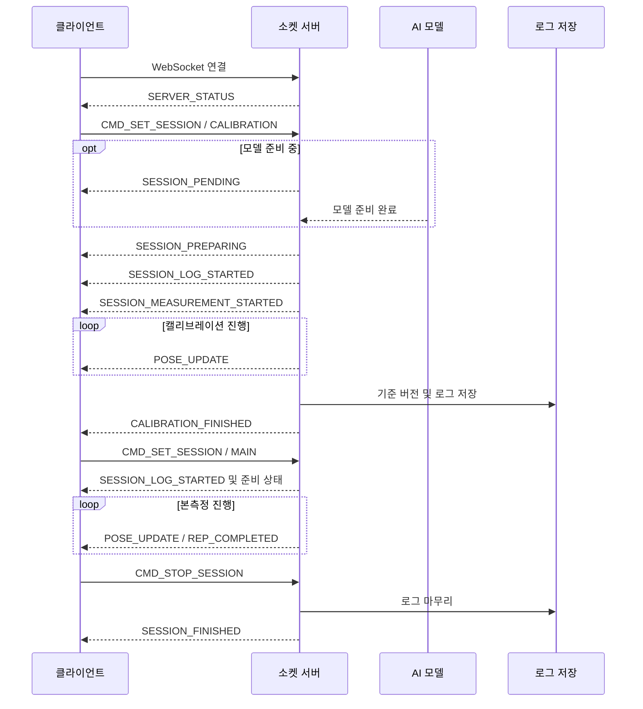

# 소켓 서버 사용 설명서

이 문서는 Streamlit·Unity·Python 등에서 현재 서버에 직접 연결하는 방법을 설명합니다. 프로젝트 실행과 운동 측정 원리는 [README](README.md), 분석 화면은 [분석 안내](analysis/README.md)를 참고하세요.

서버는 **WebSocket에 JSON 문자열을 주고받는 방식**입니다. 일반 TCP 소켓, HTTP REST API, Socket.IO와는 다릅니다. 예제 응답은 이해에 필요한 필드를 발췌한 것이며, 실제 패킷에는 추가 필드가 들어올 수 있습니다.

## 목차

1. [실행과 연결](#1-실행과-연결)
2. [연결 후 처리 순서](#2-연결-후-처리-순서)
3. [측정 시작 예제](#3-측정-시작-예제)
4. [측정 시작 필드](#4-측정-시작-필드)
5. [수신 결과와 점수](#5-수신-결과와-점수)
6. [종료와 연결 복구](#6-종료와-연결-복구)
7. [기준값 조회와 수정](#7-기준값-조회와-수정)
8. [영상과 파일 분석](#8-영상과-파일-분석)
9. [실행 가능한 Python 클라이언트](#9-실행-가능한-python-클라이언트)
10. [로그 저장과 기준 추적](#10-로그-저장과-기준-추적)
11. [오류와 연동 시 주의점](#11-오류와-연동-시-주의점)

## 1. 실행과 연결

### 서버 실행

AI 환경과 모델 파일을 준비한 뒤 프로젝트 폴더에서 실행합니다.

```powershell
conda activate rtm_env
python server_entry.py
```

기본 주소: **`ws://127.0.0.1:8080`**

Streamlit은 서버 구동에 필수가 아닙니다. 직접 연결하는 클라이언트만 있어도 됩니다. 서버 PC에 카메라 또는 입력 영상이 있어야 하며, 클라이언트 PC의 카메라 영상을 서버에 업로드하는 프로토콜은 현재 없습니다.

### 다른 PC에서 연결할 때

현재 진입점에는 host·port 명령행 옵션이 없습니다. 주소를 바꾸려면 `server_entry.py`의 서버 생성 부분을 수정합니다.

```python
server = ExerciseSocketServer(host="0.0.0.0", port=8080)
```

이 경우 클라이언트는 `ws://서버PC의IP:8080`으로 연결합니다. `0.0.0.0`은 서버가 수신할 주소이며 클라이언트 접속 주소로 쓰지 않습니다. PC 방화벽도 해당 연결을 허용해야 합니다. 현재 코드에는 사용자 인증이나 TLS 종료 기능이 없으므로, 외부 공개 서비스로 배포하려면 별도 구성이 필요합니다.

### 메시지 기본 형식

한 WebSocket 텍스트 메시지에 JSON 객체 하나를 전송합니다.

```json
{"type": "CMD_GET_SERVER_STATUS"}
```

서버는 요청의 응답 외에도 상태와 측정 이벤트를 계속 보냅니다. **한 번 보내고 바로 다음 메시지를 그 응답이라고 가정하지 마세요.** `type`별로 분기해서 처리해야 합니다. `request_id`는 종료·기준 명령 등 지원하는 응답에서 요청을 구분하는 용도입니다. 모든 명령이 이를 그대로 돌려주지는 않습니다.

## 2. 연결 후 처리 순서



위 그림은 대표 흐름입니다. 준비 알림의 순서·횟수는 상태에 따라 다르고, 준비 시간을 0으로 설정하면 별도의 측정 시작 알림이 생략될 수 있습니다. `SESSION_LOG_STARTED`는 기록 세션이 생성되었다는 뜻이며, 그 자체로 준비 시간이 끝났다는 뜻은 아닙니다.

### 모델 상태

`SERVER_STATUS`에서 아래 항목을 확인합니다.

| 필드 | 의미 |
|---|---|
| `model_state` | `NOT_STARTED`, `LOADING`, `READY`, `FAILED` |
| `phase` | `IMPORTING`, `DEVICE_SETUP`, `LOADING_YOLO`, `LOADING_POSE` 등 세부 단계 |
| `ready` | 측정 모델 준비 여부 |
| `message` | 현재 상태 안내 |
| `model_error` | 실패 원인. 정상일 때 비어 있을 수 있음 |
| `elapsed_seconds`, `phase_seconds` | 로딩 전체·현재 단계 경과 시간 |

모델 준비 전에도 `CMD_SET_SESSION`을 보낼 수 있습니다. 이때 `SESSION_PENDING`을 받고, 모델 준비 완료 후 세션을 시작합니다. 대기 중 같은 연결에서 새 시작 요청을 보내면 기존 대기 요청을 대체하므로 시작 명령을 반복 전송하지 마세요.

한 번에 측정 세션은 하나입니다. 다른 연결의 측정 요청은 `SERVER_BUSY`로 거절될 수 있습니다. 여러 환자를 동시에 측정하는 서버는 아닙니다.

## 3. 측정 시작 예제

### 3.1 캘리브레이션

```json
{
  "type": "CMD_SET_SESSION",
  "patient_id": "0000",
  "patient_name": "Demo",
  "exercise_name": "knee_extension",
  "mode": "CALIBRATION",
  "output_mode": "LIGHTWEIGHT",
  "round": 2,
  "camera_index": 0,
  "preparation_seconds": 5
}
```

좌우 각각 3회가 목표이며 서버가 완료를 결정합니다. 실시간 캘리브레이션 완료는 **`CALIBRATION_FINISHED`**로 확인하세요. 단순히 프레임의 `rep_count`가 3인 것만 보고 연결을 닫으면 기준 저장이 끝나기 전일 수 있습니다.

```json
{
  "type": "CALIBRATION_FINISHED",
  "player_id": "0000",
  "thresholds": {
    "left": {"start_val": 0.80, "target_val": 0.60},
    "right": {"start_val": 0.79, "target_val": 0.59}
  },
  "summary": {"status": "COMPLETED"}
}
```

수치는 설명용입니다. 실제 기준에는 지표·방향·정규화 등의 메타데이터도 포함됩니다. 같은 연결을 유지한 채 다음 MAIN을 시작할 수 있습니다.

### 3.2 본측정

같은 날짜·환자·동작·라운드에서 캘리브레이션을 완료한 뒤 전송합니다.

```json
{
  "type": "CMD_SET_SESSION",
  "patient_id": "0000",
  "exercise_name": "knee_extension",
  "mode": "MAIN",
  "output_mode": "LIGHTWEIGHT",
  "round": 2,
  "set": 1,
  "target_reps": 10,
  "target_score": 10.0,
  "camera_index": 0,
  "preparation_seconds": 5
}
```

`target_reps`는 목표 횟수, `target_score`는 참고 목표 점수입니다. **MAIN 종료는 클라이언트 책임**입니다. 좌우 목표 횟수를 확인하고 `CMD_STOP_SESSION`을 보내세요. `auto_stop_on_target: true`를 보내는 것만으로 서버가 종료하지도 않습니다. 현재 이 필드는 메타데이터로 기록하며 실제 자동 종료 동작은 Streamlit 클라이언트가 수행합니다.

## 4. 측정 시작 필드

### 기본 측정 조건

| 필드 | 형식 / 기본값 | 설명 |
|---|---|---|
| `type` | `"CMD_SET_SESSION"` | 시작 명령 |
| `patient_id` | 숫자 문자열, `"0000"` | 최대 4자리. 짧으면 앞에 0을 채워 사용 |
| `patient_name` | 문자열, `"Unknown"` | 환자 이름 |
| `exercise_name` | 문자열, `"biceps_curl"` | 설정 JSON에 등록된 동작 ID |
| `mode` | `CALIBRATION` / `MAIN`, 기본 CALIBRATION | 대문자로 전송. TEST 지원 안 함 |
| `output_mode` | `LIGHTWEIGHT` / `VISUAL` / `OFFLINE_VIDEO` | 기본 LIGHTWEIGHT. 영상 파일을 지정하면 파일 분석으로 전환 |
| `round` | 정수, `1` | 라운드 번호. 일반 사용은 1 이상 권장 |
| `set` | 정수, `1` | 본측정 세트. CAL 파일명에는 생략 |
| `target_reps` | 양의 정수, 생략 가능 | CAL에서는 3으로 고정 |
| `target_score` | 유한한 양수 | 생략하면 `target_reps`, 그것도 없으면 10 사용 |
| `preparation_seconds` | 0 이상의 유한한 수, `5` | 실시간 측정 시작 전 준비 시간 |
| `camera_index` | 카메라 번호, `0` | 실시간 입력 장치 번호 |
| `video_path` | 서버 PC의 파일 경로 | 파일 분석 시 사용. 절대 경로 권장 |
| `batch_size` | 양의 정수, `16` | 파일 분석에서 한 번에 추론할 프레임 수 |

`target_reps`에 `10.0`, 문자열 `"10"`, bool을 보내지 마세요. 정수 `10`을 사용합니다. 서버의 번호 검사는 일부 0을 허용하지만 앱에서는 라운드·세트·세션 등을 1 이상으로 입력합니다.

등록된 동작 ID: `biceps_curl`, `shoulder_press`, `clamshell`, `slr`, `hip_knee_flexion`, `knee_extension`.

### 저장·외부 연동 필드

| 필드 | 형식 / 기본값 | 설명 |
|---|---|---|
| `log_root` | 폴더 경로, 생략 가능 | 서버 PC 저장 루트. 기본 위치는 뒤의 저장 설명 참고 |
| `session` | 정수, 생략 가능 | 세션 구분 정보. 생략 시 저장 코드에서 처리 |
| `registration` | 1~99, 기본 1 | 등록 차수. 내부적으로 두 자리 문자열 사용 |
| `slot` | 정수, `1` | 외부 연동 슬롯 |
| `data_version` | `"v1.0.0(0)"` | `v숫자.숫자.숫자(숫자)` 형식 |
| `play_session_id` | 문자열, 생략 시 생성 | 플레이 단위 ID |
| `exercise_record_id` | 문자열, 생략 시 생성 | 운동 기록 ID |
| `patient_metadata` | JSON 객체 | 환자 부가 정보 |
| `auto_stop_on_target` | bool, `false` | 자동 종료 의도를 기록. 서버 자동 종료 기능은 아님 |
| `preview_separate` | bool, `false` | VISUAL에서 별도 감시 연결로 영상을 받을 때 사용 |

외부 ID에는 영문·숫자·밑줄·하이픈을 사용하며 길이는 1~128자입니다. 경로 구분자와 Windows 예약 장치 이름은 허용하지 않습니다. `patient_metadata`는 JSON 문자열이 아니라 객체로 전송합니다.

기존 호환 필드로 `player_id`와 `input_source`도 있지만 새 클라이언트는 `patient_id`, `video_path`를 사용하세요. `cal`은 별도로 보내지 않아도 됩니다. 보내면 `mode == "CALIBRATION"`과 일치하는 bool이어야 합니다.

## 5. 수신 결과와 점수

### 주요 이벤트

| `type` | 의미 | 클라이언트 처리 |
|---|---|---|
| `SERVER_STATUS` | 모델 준비·실패 상태 | 준비 안내 갱신 |
| `SESSION_PENDING` | 모델 준비를 기다리는 요청 | 추가 시작 요청 없이 대기 |
| `SESSION_PREPARING` | 카메라 연결·준비 카운트다운 | 안내 문구와 선택적 `remaining_seconds` 표시 |
| `SESSION_LOG_STARTED` | 로그 세션 생성 | `session_id`와 기록 정보 보관 |
| `SESSION_MEASUREMENT_STARTED` | 준비 시간 종료 | 측정 시작 안내 |
| `POSE_UPDATE` | 실시간 측정값과 상태 | 수치·바·횟수 갱신 |
| `REP_COMPLETED` | MAIN에서 한쪽 반복 확정 | 등급·점수 이벤트 처리 |
| `CALIBRATION_FINISHED` | 실시간 캘리브레이션 저장 완료 | MAIN 진행 가능 |
| `SESSION_FINISHED` | 종료 명령 처리와 저장 완료 | 최종 결과 표시 |
| `VIDEO_FRAME` | JPEG 미리보기 | Base64 디코딩해 표시 |
| `PREVIEW_STATUS` | 영상 감시 경고 | 마지막 영상과 경고 표시 |
| `VIDEO_STATUS`, `VIDEO_PROGRESS` | 파일 분석 상태 | 진행률 표시 |
| `VIDEO_ANALYSIS_COMPLETED` | 파일 분석 완료 | 결과·캘리브레이션 성공 여부 확인 |
| `ERROR` | 명령·측정 오류 | `code`와 `message` 처리 |

### POSE_UPDATE

```json
{
  "type": "POSE_UPDATE",
  "mode": "MAIN",
  "metric_type": "COORDINATE",
  "exercise_name": "knee_extension",
  "left": {
    "val": 0.66,
    "rep_count": 2,
    "state": "RETURNING",
    "quality": "GOOD",
    "score": 2,
    "score_delta": 0.5,
    "total_score": 1.5,
    "progress_ratio": 0.7,
    "is_count_updated": true
  },
  "right": {
    "val": 0.76,
    "rep_count": 1,
    "quality": "PERFECT",
    "score": 0,
    "score_delta": 0.0,
    "total_score": 1.0,
    "progress_ratio": 0.15,
    "is_count_updated": false
  },
  "is_occluded": false,
  "threshold_version": 0
}
```

수치는 설명용입니다. `quality`에는 직전 반복의 등급이 남을 수 있지만, `score`·`score_delta`는 이벤트가 없는 프레임에서 0이 됩니다. 현재 도달률이 낮아도 직전 등급이 Perfect인 것은 정상입니다.

`val`의 단위는 지표마다 다릅니다. `ANGLE`은 도, unnorm Y는 영상 높이 대비 비율, norm 좌표는 신체 기준으로 변환한 무차원 값입니다. 상대 이동량은 고정 기준 길이에 대한 비율입니다. 관절이 보이지 않을 때는 값이 비어 있을 수 있습니다.

상위 필드에는 `fps`, `calib_step`, 좌우 캘리브레이션 횟수, `thresholds`, `display_thresholds`, `measurement`, `target_reps` 등도 들어갑니다. 바의 고정 범위는 `display_thresholds` 등의 표시 정보를 참고하고, 매번 바뀌는 내부 극값으로 표시 범위를 재설정하지 마세요.

### REP_COMPLETED

```json
{
  "type": "REP_COMPLETED",
  "session_id": "session-id-example",
  "exercise_name": "knee_extension",
  "mode": "MAIN",
  "metric_type": "COORDINATE",
  "side": "left",
  "rep_id": 2,
  "quality": "GOOD",
  "score": 2,
  "score_delta": 0.5,
  "total_score": 1.5,
  "threshold_version": 0,
  "timestamp": 12.3,
  "val": 0.66
}
```

실제로는 `play_session_id`, `exercise_record_id`, `sensor_file_id`도 들어갑니다. `timestamp`는 측정 시작 이후의 초이며 파일 분석에서는 영상 내 시간입니다. `val`은 이벤트 시점의 값으로, 반복의 최고 도달값 자체와는 다를 수 있습니다.

같은 반복이 `POSE_UPDATE`와 `REP_COMPLETED` 양쪽에 나타나므로 **두 패킷에서 각각 점수를 더하면 중복**됩니다. 이벤트 중복 제거에는 `(session_id, side, rep_id)`를 사용할 수 있습니다.

### 점수 읽기

| 화면 | `quality` | `score` | `score_delta` | 기준 범위의 최고 도달 비율 |
|---|---|---|---|---|
| Perfect | `PERFECT` | 3 | 1.00 | 70% 이상 |
| Good | `GOOD` | 2 | 0.50 | 50% 이상 70% 미만 |
| Normal | `BAD` | 1 | 0.25 | 35% 이상 50% 미만 |

**`score`는 판정 코드, `score_delta`는 이번 가점, `total_score`는 누적값입니다.** `total_score`를 매 프레임 더하면 안 됩니다. 이 표는 현재 3등급 MAIN 방식의 규칙입니다. CAL이나 별도 설정의 상대 이동량·목표 위치 전용 방식에 같은 규칙을 그대로 적용하지 마세요.

현재 knee MAIN은 35% 이상, 다른 등록 MAIN은 40% 이상 움직여야 합니다. 이후 최고점에서 전체 기준 범위의 5% 이상 돌아오면 카운트합니다. 다음 반복을 받으려면 knee는 15% 이하, 다른 동작은 30% 이하로 복귀해야 합니다.

## 6. 종료와 연결 복구

### 일반 종료

세션을 소유한 연결에서 보냅니다. `session_id`는 생략 가능하지만 현재 세션 ID를 붙이면 대상이 잘못된 경우를 검출할 수 있습니다.

```json
{
  "type": "CMD_STOP_SESSION",
  "session_id": "session-id-example",
  "request_id": "stop-001",
  "reason": "USER_STOP"
}
```

MAIN에서 목표를 달성했다면 `reason: "TARGET_REACHED"`를 사용할 수 있습니다. 서버는 이 요청에 따라 완료 상태로 기록하므로 보내기 전에 클라이언트가 달성 조건을 확인해야 합니다. CAL 완료는 서버가 판단하므로 이 사유로 CAL을 종료하면 거절됩니다.

```json
{
  "type": "SESSION_FINISHED",
  "session_id": "session-id-example",
  "request_id": "stop-001",
  "reason": "USER_STOP",
  "status": "STOPPED",
  "summary": {"status": "STOPPED"}
}
```

- `TARGET_REACHED`는 `COMPLETED`, 다른 수동 종료는 `STOPPED`로 기록합니다.
- 모델 준비 대기 중인 시작 요청도 취소할 수 있습니다. 이 경우 `summary`는 `null`입니다.
- 종료 후에도 WebSocket을 유지하며 다음 세션을 시작할 수 있습니다.
- 파일 정보와 최종 집계는 `summary`에서 확인합니다.

클라이언트 자체 최종 결과를 첨부하려면 다음 형식도 사용할 수 있습니다. 서버 측정값을 다시 계산하는 기능은 아닙니다.

```json
{
  "type": "CMD_STOP_SESSION",
  "reason": "TARGET_REACHED",
  "client_result": {
    "target_score": 10,
    "scores": {"left": 10.5, "right": 10.0}
  }
}
```

### 연결 끊김과 복구

측정 소유 연결이 끊기면 해당 세션의 로그를 저장·정리합니다. 서버 전체나 모델이 종료되지는 않습니다. 재연결해서 이전 측정 중간부터 재개하는 기능은 없습니다.

이전 연결이 남아 `SERVER_BUSY`가 발생하면 **별도의 감시 연결**에서 보냅니다.

```json
{"type": "CMD_RESET_SESSION", "request_id": "reset-001"}
```

성공 응답은 `SERVER_SESSION_RESET`이며 `reset`은 이전 소유 연결이 있었는지 나타냅니다. 소유 연결 자체에서 리셋하면 `RESET_FROM_MONITOR_REQUIRED`입니다. 정상적인 종료는 `CMD_STOP_SESSION`을 사용하세요.

리셋은 기존 연결을 닫고 정리를 기다립니다. `SESSION_RESET_TIMEOUT`이면 상태를 확인하고 처리가 끝난 뒤 다시 시도하세요. 다른 환자의 진행 중 측정을 중단하지 않도록 대상을 확인해야 합니다.

기존 `CMD_STOP_CALIBRATION` 명령도 남아 있지만 필요한 측정 데이터를 만들어 주지는 않습니다. 일반 중단은 `CMD_STOP_SESSION`, 정상 완료는 `CALIBRATION_FINISHED`로 처리합니다.

## 7. 기준값 조회와 수정

### 조회

진행 중인 세션에 전송합니다.

```json
{
  "type": "CMD_GET_COUNT_THRESHOLD",
  "exercise_name": "knee_extension",
  "request_id": "get-threshold-001"
}
```

응답은 `COUNT_THRESHOLD_STATUS`입니다. `thresholds`, `display_thresholds`, `threshold_version`, 좌우 상태와 측정 정보 등이 들어갑니다. 세션이 없으면 `NO_ACTIVE_SESSION`, 동작명이 다르면 `EXERCISE_MISMATCH`입니다.

### MAIN에서 일시 수정

다음은 knee MAIN의 영상 Y 좌표에 대한 예시입니다. 해당 환자의 저장값을 확인한 뒤 수정하세요.

```json
{
  "type": "CMD_UPDATE_COUNT_THRESHOLD",
  "exercise_name": "knee_extension",
  "request_id": "update-threshold-001",
  "thresholds": {
    "left": {"start_val": 0.80, "target_val": 0.60},
    "right": {"start_val": 0.79, "target_val": 0.59}
  }
}
```

- MAIN에서만 변경할 수 있습니다. CAL에서는 `INVALID_MODE`입니다.
- 한쪽 또는 일부 필드만 변경할 수 있습니다.
- 증가 방향은 시작＜목표, 감소 방향은 시작＞목표여야 합니다. 같은 값이나 잘못된 수는 사용할 수 없습니다.
- 검증 후 적용하며 `COUNT_THRESHOLD_UPDATED`, `changed_sides`, 새 `threshold_version`을 반환합니다.
- 완료된 횟수·점수는 유지합니다. 진행 중 동작은 새 범위로 복귀한 뒤 다시 받습니다.
- `scope: "SESSION"`이며 **저장된 캘리브레이션 JSON을 수정하지 않습니다.**

저장 기준을 갱신하려면 같은 조건으로 다시 캘리브레이션해 새 버전을 만듭니다. 세션 내 `threshold_version`과 파일명의 `v01` 등은 서로 다른 번호입니다.

## 8. 영상과 파일 분석

### 8.1 VISUAL 영상

`output_mode: "VISUAL"`로 시작하면 수치와 함께 `VIDEO_FRAME`을 받을 수 있습니다. 영상 부분은 최대 640×360으로 축소하고 JPEG 품질 60, 최대 10 FPS로 보냅니다. 우측 정보 패널을 붙인 최종 너비는 더 클 수 있습니다.

`VIDEO_FRAME`의 주요 필드입니다.

| 필드 | 내용 |
|---|---|
| `encoding` | `jpeg` |
| `image_base64` | JPEG의 Base64 문자열 |
| `width`, `height` | 최종 이미지 크기 |
| `timestamp` | 세션 내 시간 |
| `warning`, `notice` | 별도 감시 연결의 경고·안내. 항상 있는 필드는 아님 |

디코딩 예입니다. 실제 앱에서는 수신과 그리기를 분리하면 화면 갱신 때문에 통신이 지연되는 일을 줄일 수 있습니다.

```python
import base64
import cv2
import numpy as np

def decode_frame(packet):
    data = base64.b64decode(packet['image_base64'])
    return cv2.imdecode(np.frombuffer(data, dtype=np.uint8), cv2.IMREAD_COLOR)
```

### 8.2 측정과 독립된 카메라 감시

준비 중이나 측정 종료 후에도 영상을 보려면 측정 연결과 **별도 WebSocket 연결**에서 전송합니다.

```json
{
  "type": "CMD_WATCH_CAMERA",
  "camera_index": 0,
  "exercise_name": "knee_extension"
}
```

감시 연결은 영상 전용 루프에 들어갑니다. 같은 연결에서 이어서 측정 제어를 하지 마세요. 감시를 끝내려면 해당 연결을 닫습니다. 측정 시작 요청에 `preview_separate: true`를 붙이면 제어 연결로 영상을 이중 전송하지 않습니다.

측정과 같은 카메라 번호를 지정합니다. 모델 준비·측정 대기·관절 누락 등의 안내가 붙을 수 있습니다. 영상이 나와도 AI 측정이 유효하다는 뜻은 아니므로 경고와 수치도 확인하세요. 기기가 실제로 끊기면 새 영상은 받을 수 없습니다.

스켈레톤은 스무딩 전, 바·횟수·측정값은 필터 적용 후입니다. MP4는 축소 영상 대신 원본 해상도로 저장하고 스켈레톤은 넣지 않습니다.

### 8.3 파일 분석

```json
{
  "type": "CMD_SET_SESSION",
  "patient_id": "0000",
  "exercise_name": "knee_extension",
  "mode": "CALIBRATION",
  "round": 2,
  "output_mode": "OFFLINE_VIDEO",
  "video_path": "C:/videos/knee_extension.mp4",
  "batch_size": 16
}
```

경로는 **소켓 서버 PC** 기준입니다. 클라이언트의 로컬 파일을 자동 전송하지 않습니다. JSON에 Windows 경로를 쓸 때는 예시처럼 `/`를 쓰거나 역슬래시를 `\\`로 작성합니다.

처리는 두 단계입니다.

1. `EXTRACTING`: 영상을 읽고 배치 추론으로 관절을 추출합니다.
2. `ANALYZING`: 영상 내 시각을 기준으로 필터·상태 머신을 순서대로 실행합니다.

`VIDEO_PROGRESS`의 `phase`, `processed_frames`, `total_frames`로 진행을 확인합니다. 전체 관절을 메모리에 보관하므로 긴 영상에서는 메모리 사용량도 늘어납니다.

자연 종료는 `VIDEO_ANALYSIS_COMPLETED`입니다. CAL은 `calibration_completed`, `calib_step`도 확인하세요. 영상이 끝나도 필요한 3회에 못 미치면 `summary.status`는 `INCOMPLETE`이며 새 확정 기준을 만들지 않습니다.

MAIN 파일 분석도 같은 조건의 사전 캘리브레이션이 필요합니다. MAIN의 `REP_COMPLETED`를 받을 수 있지만 실시간처럼 `POSE_UPDATE`가 계속 오는 것을 전제로 작성하지 마세요.

분석 중에는 현재 세션에 대한 중단 명령만 받으며 다른 명령은 `VIDEO_COMMAND_REJECTED`가 될 수 있습니다. 중단은 배치 경계 등에서 확인하므로 즉시 처리되지 않을 수 있습니다. 중단 요청에 따른 완료 응답은 `SESSION_FINISHED`입니다.

`video_path`를 보내면 출력 방식을 생략해도 파일 분석으로 전환됩니다. `VISUAL`과 `video_path`를 함께 보내면 거절됩니다.

### 8.4 실험 모드 끄기

`network/session_commands.py`의 `ENABLE_EXPERIMENTAL_MODES = False`로 설정하면 `LIGHTWEIGHT`만 제공합니다. `network/experimental_modes.py`를 제거하는 구성도 지원합니다. 꺼진 영상 모드를 요청하면 시작 오류가 발생합니다.

## 9. 실행 가능한 Python 클라이언트

아래 코드를 `example_client.py` 등에 저장하고 서버 실행 후 실행합니다. `websockets.py`라는 이름은 패키지와 충돌하므로 피하세요.

```powershell
conda activate rtm_env
python example_client.py
```

이 예제는 **실제 카메라에서 CAL→MAIN을 진행하고 좌우 각각 10회에서 종료**합니다. CAL만 하려면 `main()`의 두 번째 `run_session` 호출을 생략합니다. 입력 필드는 환경에 맞게 바꾸세요.

```python
import asyncio
import json
import websockets

URI = 'ws://127.0.0.1:8080'
TARGET = 10
BASE = {
    'patient_id': '0000',
    'exercise_name': 'knee_extension',
    'round': 2,
    'output_mode': 'LIGHTWEIGHT',
    'camera_index': 0,
    'preparation_seconds': 5,
}


async def run_session(ws, mode):
    request = {
        **BASE, 'type': 'CMD_SET_SESSION', 'mode': mode,
        'set': 1, 'target_reps': TARGET, 'target_score': 10.0,
    }
    await ws.send(json.dumps(request))
    session_id = None
    counts = {'left': 0, 'right': 0}
    stop_sent = False
    print(f'[{mode}] 시작 요청 전송')

    async for raw in ws:
        packet = json.loads(raw)
        kind = packet.get('type')
        if kind == 'ERROR':
            raise RuntimeError(f"{packet.get('code')}: {packet.get('message')}")
        if kind == 'SERVER_STATUS':
            if packet.get('model_state') == 'FAILED':
                raise RuntimeError(packet.get('model_error'))
            print('모델 상태:', packet.get('phase'))
        elif kind in ('SESSION_PENDING', 'SESSION_PREPARING',
                      'SESSION_MEASUREMENT_STARTED'):
            print(packet.get('message', kind))
        elif kind == 'SESSION_LOG_STARTED':
            session_id = packet['session_id']
            print('로그 세션:', session_id)
        elif kind == 'REP_COMPLETED':
            side = packet['side']
            counts[side] = max(counts[side], packet['rep_id'])
            print(side, counts[side], packet.get('quality'),
                  '추가 점수:', packet.get('score_delta'),
                  '누적:', packet.get('total_score'))
        elif kind == 'POSE_UPDATE' and mode == 'MAIN':
            for side in counts:
                counts[side] = max(counts[side], packet[side]['rep_count'])
        elif kind == 'CALIBRATION_FINISHED' and mode == 'CALIBRATION':
            print('캘리브레이션 저장 완료:', packet.get('summary'))
            return packet
        elif kind == 'SESSION_FINISHED':
            if mode == 'CALIBRATION':
                raise RuntimeError('캘리브레이션 완료 전에 종료되었습니다.')
            print('본측정 저장 완료:', packet.get('summary'))
            return packet

        # 두 종류의 패킷으로 횟수를 확인하되 종료 명령은 한 번만 보냅니다.
        if mode == 'MAIN' and not stop_sent and min(counts.values()) >= TARGET:
            stop = {'type': 'CMD_STOP_SESSION', 'reason': 'TARGET_REACHED',
                    'request_id': 'finish-main-001'}
            if session_id is not None:
                stop['session_id'] = session_id
            await ws.send(json.dumps(stop))
            stop_sent = True

    raise ConnectionError('완료 응답 전에 연결이 닫혔습니다.')


async def main():
    async with websockets.connect(URI, max_size=16 * 1024 * 1024,
                                  compression=None) as ws:
        await run_session(ws, 'CALIBRATION')
        await run_session(ws, 'MAIN')


if __name__ == '__main__':
    asyncio.run(main())
```

수치 전용 예제라 영상 디코딩은 필요하지 않습니다. GUI·Unity 구현에서도 수신·화면 갱신·종료 판정을 나눠 처리할 수 있습니다. 환자번호·동작·라운드·데이터 버전·등록 차수를 바꾸면 다른 측정 조건이 된다는 점을 주의하세요.

## 10. 로그 저장과 기준 추적

기본 경로는 `data/환자번호/날짜/동작/`입니다. 루트는 시작 요청의 `log_root` → 환경변수 `ASAN_LOG_ROOT` → 프로젝트 `data` 순으로 정합니다.

| 용도 | 파일명 예 |
|---|---|
| CAL 로그 3종 | `09-00-00_CALIBRATION_round02.csv` / `.npz` / `.mp4` |
| MAIN 로그 3종 | `09-10-00_MAIN_round02_set01.csv` / `.npz` / `.mp4` |
| 기준 버전 | `round02_thresholds_v01.json` |

같은 이름에는 `_take2` 등을 붙이고 재CAL은 `v02` 등을 만들어 과거 파일을 남깁니다. 라운드 폴더나 세션마다 별도 요약 JSON을 만들지는 않습니다.

MAIN은 같은 환자·시작일·동작·라운드·데이터 버전·등록의 최신 확정 CAL을 읽습니다. NPZ의 `summary_json.calibration`에는 적용 버전과 기준값 사본을 남깁니다. CSV에도 `calibration_file`·`calibration_version` 등의 열이 있습니다. CAL 측정 중 CSV 행에는 종료 후 생성되는 버전이 아직 없어서 비어 있을 수 있습니다.

다른 날짜·라운드의 CAL이나 예전 환자 공통 JSON으로 자동 대체하지 않습니다. 날짜가 바뀐 뒤 MAIN을 시작한다면 새 날짜의 CAL이 필요합니다. 기준 파일의 자동 삭제 기능은 없습니다.

CSV·NPZ에는 **당시 필터·기준·상태 머신으로 얻은 측정 결과**가 기록됩니다. NPZ의 관절 자체는 스무딩 전 추출 좌표입니다. 로그를 읽는 것만으로 새로운 방식으로 재판정하지는 않습니다.

## 11. 오류와 연동 시 주의점

### 주요 오류 코드

| 코드 | 의미와 대응 |
|---|---|
| `INVALID_MODE` | 측정 모드나 해당 조작이 부적절. CALIBRATION/MAIN 확인 |
| `INVALID_OUTPUT_MODE` | 출력 방식·영상 경로 조합·실험 기능 활성 상태 확인 |
| `SERVER_BUSY` | 다른 연결이 측정 중. 소유 연결에서 종료하거나 필요시 복구 |
| `MODEL_LOAD_FAILED` | 모델 준비 실패. 메시지와 서버 예외 확인 |
| `SESSION_START_FAILED` | 카메라·입력·CAL 누락·불일치 등으로 시작 실패 |
| `VIDEO_ANALYSIS_FAILED` | 입력 영상·측정 조건·모델 처리 등 실패 |
| `INVALID_BATCH_SIZE` | 배치 크기를 양의 정수로 지정 |
| `SESSION_PROCESSING_FAILED` | 실행 중 오류. 로그 상태와 서버 예외 확인 |
| `NO_ACTIVE_SESSION` | 대상 세션이 없거나 소유 연결이 아님 |
| `SESSION_MISMATCH` | 종료 대상의 `session_id` 불일치 |
| `EXERCISE_MISMATCH` | 기준 명령의 동작명이 현재 세션과 다름 |
| `INVALID_THRESHOLD` | 잘못된 기준값. 방향·범위·숫자 형식 확인 |
| `RESET_FROM_MONITOR_REQUIRED` | 소유 연결에서는 리셋 대신 일반 종료 사용 |
| `SESSION_RESET_TIMEOUT` | 이전 연결 정리 대기. 상태 확인 후 재시도 |
| `VIDEO_COMMAND_REJECTED` | 파일 분석 중 지원하지 않는 명령 |

모든 오류에 전용 코드가 있는 것은 아닙니다. `ERROR`의 `message`도 표시하세요. 정의되지 않은 모든 명령에 오류 응답을 보장하지는 않으므로 문서에 있는 명령을 사용합니다.

### 연동 확인 순서

1. 연결 후 `SERVER_STATUS`를 받을 수 있는지 확인합니다.
2. CAL 시작 후 `SESSION_LOG_STARTED`를 확인합니다.
3. `POSE_UPDATE`의 유효한 측정값과 좌우 횟수를 확인합니다.
4. `CALIBRATION_FINISHED` 후 기준 JSON이 생겼는지 확인합니다.
5. 같은 조건의 MAIN에서 `REP_COMPLETED`의 등급·가점·누적값을 확인합니다.
6. 종료 명령 후 `SESSION_FINISHED`와 MP4·CSV·NPZ를 확인합니다.

같은 연결에 여러 작업이 동시에 `recv()`를 호출하지 않도록 수신 창구를 하나로 두고 `type`으로 분기합니다. 영상을 감시 전용 연결로 분리하면 수치·제어 흐름을 관리하기 쉽습니다.

구현은 [소켓 서버](network/socket_server.py), [명령 처리](network/session_commands.py), [Streamlit 통신](network/streamlit_live.py)에서 확인할 수 있습니다.
